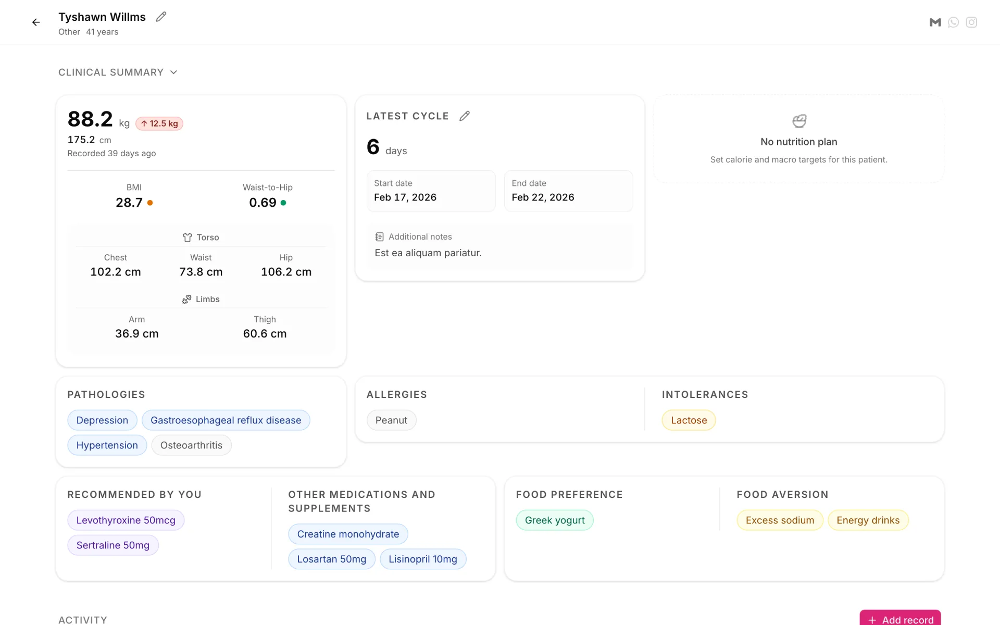

# Chironium

**Open-source practice management for health and wellness professionals.**

Personal trainers, nutritionists, and physicians use Chironium to follow the people they care for: profiles, measurements, conditions, plans, and progress in one place, on any screen.

[](https://github.com/sealambda/chironium/actions/workflows/pr-validation.yml)
[](LICENSE)

<picture>
  <source media="(prefers-color-scheme: dark)" srcset="docs/images/detail-dark.webp">
  
</picture>

> [!NOTE]
> Chironium is pre-1.0 and under active development. Expect breaking changes to the data model and the GraphQL API between releases.

## Features

- **Customer profiles and onboarding.** A guided multi-step wizard, contact details, and an activity feed of every clinical record.
- **Anthropometry.** Weight, height, and body circumferences, with BMI and waist-to-hip ratio calculated automatically.
- **Clinical history.** Conditions, allergies and intolerances, medications and supplements, coded with SNOMED CT, LOINC, and RxNorm.
- **Nutrition plans.** Calorie and macronutrient targets with live balance checks.
- **Menstrual cycle tracking,** questionnaires, clinical notes, goals, and tasks.
- **Care teams and subscriptions.** Assign practitioners to customers and track plan progress and renewals.
- **Multi-tenant organizations.** Each organization's data is isolated, with role-based permissions for its members.
- **Standards-based.** The data model follows HL7 FHIR, and everything is available through a GraphQL API.
- **Localized.** English and Spanish, with locale-aware dates and units.

## Quick start

You need [mise](https://mise.jdx.dev) (it installs the pinned Elixir, Erlang, Node.js, and pnpm versions) and Docker for the database.

```sh
mise install
docker compose up -d --wait   # PostgreSQL 18 with pgvector
mix setup                     # dependencies, database, frontend build
mix chironium.seed            # demo organization; prints an invite code
mix phx.server
```

Open [localhost:4000](http://localhost:4000), choose **Sign in as developer**, then **Join with invitation** and paste the invite code from the seed output. No Google credentials are needed in development.

If port 5432 is already taken, run `export PGPORT=5433` before the commands above.

## Email

`RESEND_API_KEY` turns email on. In development any value works, and mail goes to the local mailbox at [`/dev/mailbox`](http://localhost:4000/dev/mailbox) instead of being sent. Without the key, nothing is emailed: practitioners share invitations and questionnaires as links.

## Documentation

| Guide | Contents |
| --- | --- |
| [Contributing](CONTRIBUTING.md) | Development workflow, quality checks, and the Contributor License Agreement |
| [Self-hosting](docs/self-hosting.md) | Docker image, configuration reference, and production operations |
| [Clinical terminologies](docs/terminology.md) | Importing SNOMED CT and LOINC releases |
| [Security policy](SECURITY.md) | How to report a vulnerability |

In development, a GraphQL playground runs at [localhost:4000/gql/playground](http://localhost:4000/gql/playground).

## Built with

[Elixir](https://elixir-lang.org), [Phoenix](https://www.phoenixframework.org), and the [Ash Framework](https://ash-hq.org) on PostgreSQL, with Oban for background jobs and AshGraphql for the API. The frontend is React and TypeScript with Vite, Tailwind CSS, TanStack Router and Query, and Paraglide for translations.

## Contributing

Contributions are welcome. Read [CONTRIBUTING.md](CONTRIBUTING.md) to get started; you sign the [Contributor License Agreement](CLA.md) once, on your first pull request. Everyone taking part follows the [Code of Conduct](CODE_OF_CONDUCT.md).

## License

Copyright © 2026 Sealambda GmbH and the Chironium contributors. Chironium is licensed under the [GNU Affero General Public License v3.0 only](LICENSE): if you run a modified version as a network service, you must offer its source code to its users.

[Sealambda GmbH](https://sealambda.com) also offers hosted and commercially licensed editions for organizations that cannot meet the AGPL's terms; write to hello@sealambda.com.

The clinical terminologies that Chironium references, including SNOMED CT and LOINC, have their own licenses; see [NOTICE.md](NOTICE.md). "Chironium" and the Chironium logo are trademarks of Sealambda GmbH. You may say your software is based on Chironium, but not present a modified version as an official Sealambda release.

## Disclaimer

Chironium is a record-keeping and workflow tool. It does not provide medical advice and is not certified as a medical device. Organizations that deploy it are responsible for complying with the laws that apply to them, including data protection (such as the GDPR or HIPAA), medical device regulations (such as the EU MDR), and terminology licenses.
