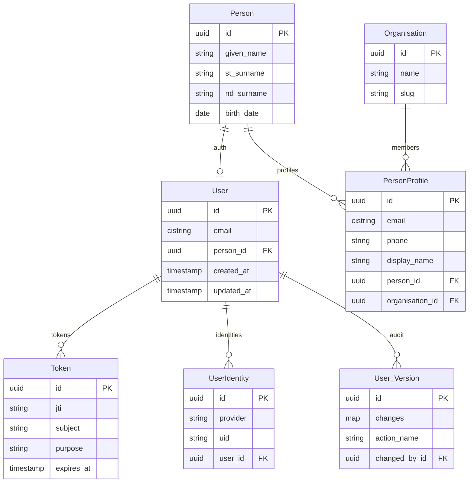
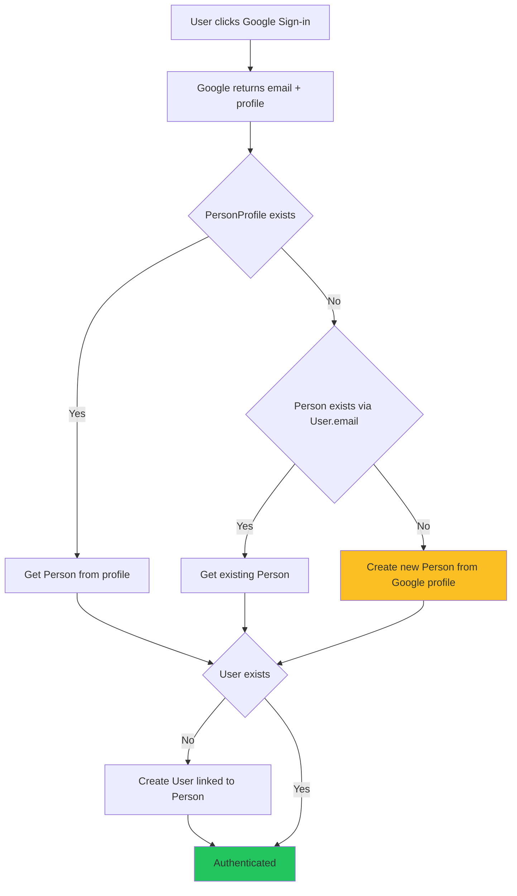
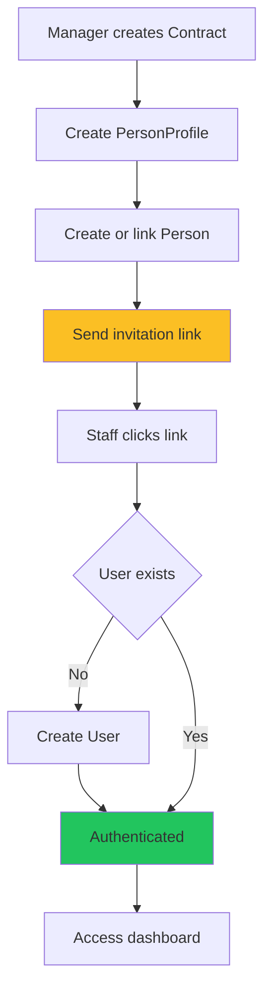
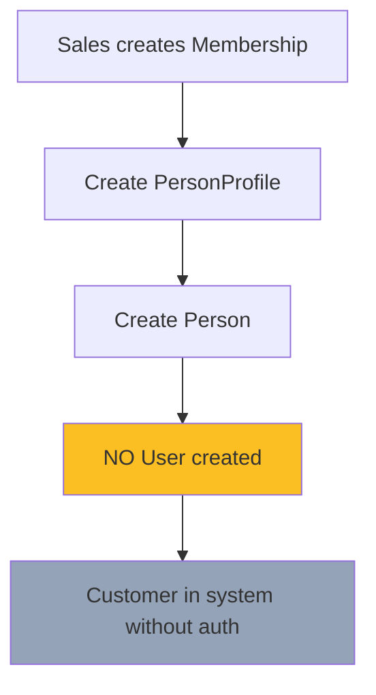
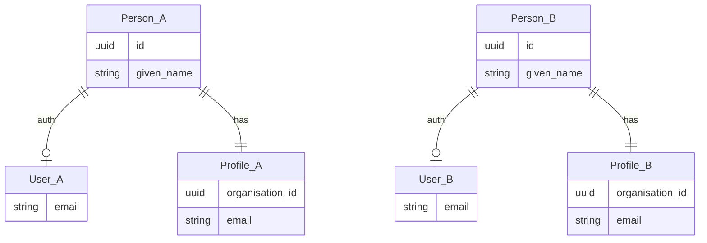
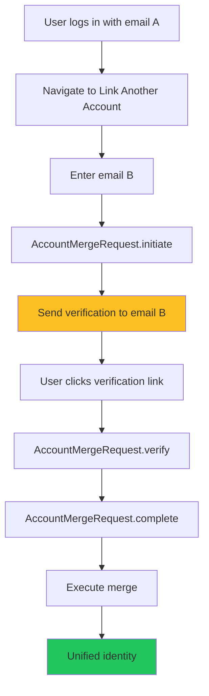
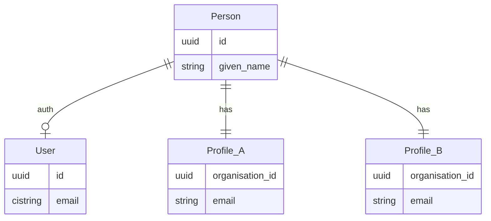
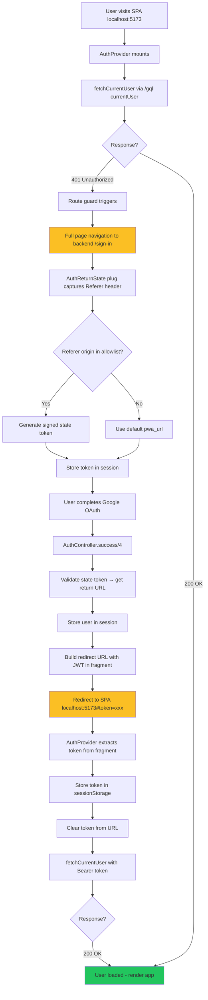
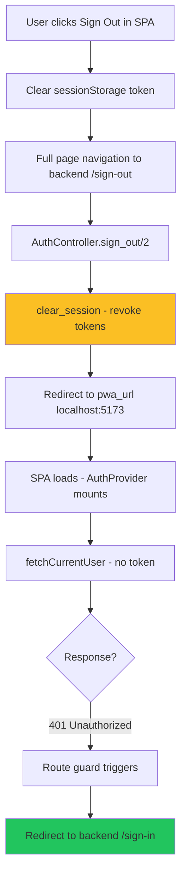

# Authentication Architecture

## Overview

Chironium uses a **hybrid authentication model**:

- **Sign-up is open** via Google SSO - anyone can create an account.
- **Organisation access is invite-only** - joining an org requires an invitation.

This allows users to sign up freely and explore the app, but organisation-specific features (staff dashboard, customer management) require being invited to an organisation.

### User Types & Authentication Behavior

| User Type    | Self Sign-up? | Auth Methods    | Person Record Created   | PersonProfile Created           |
| ------------ | ------------- | --------------- | ----------------------- | ------------------------------- |
| **New User** | ✅ Yes        | Google SSO only | On first sign-up        | ❌ No (until invited to an org) |
| **Staff**    | ✅ Yes        | Google SSO only | On first authentication | On Contract creation            |
| **Customer** | ❌ No         | N/A (future)    | On invitation           | On Membership creation          |

**New Users** can sign up via Google SSO at any time. A Person record is created for them automatically using their Google profile data. However, they won't have any PersonProfile until they're invited to an organisation. This means they can access basic app features but not org-specific functionality.

**Staff** are users who have been invited to an organisation via Contract. They authenticate via Google SSO. If they signed up before being invited, the Contract links their existing Person to the organisation.

**Customers** do not currently have authentication capability. Customer authentication will be added in a future release.

### Diagram Color Legend

| Color                 | Meaning              |
| --------------------- | -------------------- |
| 🟢 Green (`#22c55e`)  | Success / Completed  |
| 🔴 Red (`#ef4444`)    | Error / Failed       |
| 🟡 Yellow (`#fbbf24`) | Pending / In-flight  |
| ⚪ Gray (`#94a3b8`)   | Inactive / No action |

## Data Model



### Key Design Decisions

| Entity            | Purpose                           | Email?                   |
| ----------------- | --------------------------------- | ------------------------ |
| **Person**        | Pure identity (legal name, DOB)   | ❌ No                    |
| **PersonProfile** | Org-specific contact & prefs      | ✅ Yes (per org)         |
| **User**          | Authentication & token management | ✅ Yes (synced on login) |
| **Token**         | JWT storage & revocation          | N/A                      |
| **UserIdentity**  | OAuth provider identities         | N/A                      |
| **User.Version**  | Audit trail (Paper Trail)         | N/A                      |

### Why This Design?

1. **Same person, multiple orgs**: María can be `maria@gyma.com` at Gym A and `m.garcia@clinicb.com` at Clinic B.
2. **Single identity**: One Person, one User, multiple PersonProfiles.
3. **Org-scoped contact**: Each org manages their own contact info.
4. **No "primary" email confusion**: All emails are equal, just org-specific.
5. **Lazy User creation**: User is only created on first authentication, not during invitation.
6. **Full audit trail**: All User changes tracked via Paper Trail with actor attribution.

## Authentication Strategies

### 1. Google OAuth (Open Sign-up)

**Use case**: Any user signing up or signing in via Google.

**Who can use it**: Anyone with a Google account.

**Flow for new users (no existing Person)**:



**Key points**:

- If the email matches an existing PersonProfile, sign in as that Person.
- If no PersonProfile but email matches an existing User, sign in as that Person.
- If neither exists, create a new Person from Google profile data (given_name, family_name).
- PersonProfile is NOT created on sign-up - only Person and User.

**Development Note**: Google OAuth app is unverified. Only GCP OAuth testers can authenticate, naturally restricting access to the dev team.

## Invitation Flows

### Staff Invitation (Contract)

When a staff member is invited, we create Person + PersonProfile + Contract. The User is **NOT** created yet - it will be created when they first authenticate.



**After first auth**: Staff can authenticate anytime via Google SSO.

### Customer Onboarding (Membership)

When a customer is onboarded, we create Person + PersonProfile + Membership but **NOT** a User. Customer authentication will be added in a future release.



**Note**: Customers exist in the system for CRM/billing purposes without authentication capability.

## Account Merge Flow

### The Problem: Duplicate Identities

When the same real-world person is onboarded by different organisations with different emails, duplicate records are created:



**Scenario**:

1. Gym A onboards María with `maria@gyma.com` → Creates PersonProfile₁, Person₁, (User₁ if needed).
2. Clinic X onboards the same María with `m.garcia@clinicx.com` → Creates PersonProfile₂, Person₂, (User₂ if needed).
3. María now has two separate identities in the system.

### Why This Happens

- Email is the only identifier we have at onboarding.
- Different emails = no way to know it's the same person.
- We cannot assume two different emails belong to the same person.

### Solution: Self-Service Account Merge ✅

**Implementation**: `Chironium.Core.Identity.AccountMergeRequest`

María can self-merge her accounts through a verified flow:



### Merge Request States

| State       | Description                             |
| ----------- | --------------------------------------- |
| `pending`   | Awaiting verification from target email |
| `verified`  | Target email confirmed, ready for merge |
| `completed` | Merge successfully executed             |
| `cancelled` | User cancelled the request              |
| `expired`   | Verification token expired (24h)        |

### Merge Execution Details

When `AccountMergeRequest.complete/2` is called, the system:

1. **Reassigns PersonProfiles**: All PersonProfiles from target Person → initiator Person.
2. **Transfers health data**: BiometricRecord, MenstrualCycle, HealthProfile, NutritionPlan, Diagnosis.
3. **Transfers contracts/memberships**: Contract, Membership, Assignment.
4. **Deletes orphaned records**: Target User and Person are deleted.
5. **Logs audit event**: AuthEvent with type `:account_merge_completed`.

```elixir
# Merge execution pseudo-code
def execute_merge(changeset, _ctx) do
  initiator_user = get_initiator_user()
  target_person = get_target_person()
  initiator_person = initiator_user.person

  # Reassign all PersonProfiles
  reassign_person_profiles(target_person.id, initiator_person.id)

  # Transfer health data
  transfer_biometric_records(target_person.id, initiator_person.id)
  transfer_menstrual_cycles(target_person.id, initiator_person.id)
  # ... etc

  # Delete orphaned User (if exists)
  delete_target_user(target_person.id)

  # Delete orphaned Person
  delete_target_person(target_person.id)

  # Log audit event
  log_auth_event(:account_merge_completed, initiator_user.id)
end
```

### Verification Email

Sent via `Chironium.Core.Identity.Senders.MergeVerificationSender`:

- Contains verification link with token.
- 24-hour expiry notice.
- HTML and plain text versions.
- Clear explanation of what merge will do.

### After Merge



María can now log in with either email and sees both orgs in a single session.

## SPA/PWA Authentication Integration

The React SPA/PWA runs on a separate origin (Vite dev server at `localhost:5173`) and relies entirely on the Phoenix backend for authentication. This section documents how the frontend integrates with the backend auth system.

### Architecture Principles

| Principle                    | Description                                                                 |
| ---------------------------- | --------------------------------------------------------------------------- |
| **Backend-owned auth**       | All authentication logic lives in the Elixir backend via AshAuthentication. |
| **No client-side auth logic**| The SPA only checks session status - never handles credentials directly.    |
| **Secure redirects**         | Return URLs validated server-side against an allowlist, not client-provided.|
| **Cross-origin support**     | JWT tokens passed via URL fragment for cross-origin development setup.      |

### Sign-In Flow (SPA → Backend → SPA)



### Sign-Out Flow (SPA → Backend → SPA → Backend)



### Security Mechanisms

#### Secure Return URL Handling

Instead of trusting client-provided `return_to` query parameters (open redirect vulnerability), the backend:

1. **Captures Referer header** - `AuthReturnState` plug extracts the Referer on `/sign-in`, `/register`, `/reset`.
2. **Validates origin** - Only origins in `allowed_pwa_origins` config are accepted.
3. **Generates signed token** - `Phoenix.Token.sign/4` creates a time-limited (10 min) state token.
4. **Stores in session** - Token stored in session, not exposed to client.
5. **Validates on success** - `AuthController.success/4` verifies token before redirecting.

```elixir
# config/dev.exs
config :chironium,
  pwa_url: "http://localhost:5173",
  allowed_pwa_origins: ["http://localhost:5173"]

# config/runtime.exs (production)
config :chironium,
  pwa_url: System.get_env("PWA_URL", "/app"),
  allowed_pwa_origins:
    System.get_env("ALLOWED_PWA_ORIGINS", "")
    |> String.split(",", trim: true)
    |> Enum.map(&String.trim/1)
```

#### JWT Token in URL Fragment

For cross-origin setups (SPA on different port), session cookies don't work for API calls. The backend passes the JWT token via URL fragment:

| Aspect              | Why URL Fragment (#) over Query Param (?)                              |
| ------------------- | ---------------------------------------------------------------------- |
| **Not sent to server** | Fragments are client-only, not included in HTTP requests.           |
| **Not logged**       | Server access logs don't capture fragments.                           |
| **Cleared immediately** | SPA extracts, stores, and clears from URL via `history.replaceState`. |

```typescript
// Frontend token extraction (auth.tsx)
function extractTokenFromFragment(): string | null {
  const hash = window.location.hash
  if (!hash.includes("token=")) return null

  const params = new URLSearchParams(hash.substring(1))
  const token = params.get("token")

  // Clear immediately - even if invalid
  const cleanUrl = window.location.href.split("#")[0]
  window.history.replaceState(null, "", cleanUrl)

  // Validate JWT format (3 dot-separated segments)
  if (!token || token.split(".").length !== 3) return null
  return token
}
```

#### Token Revocation on Sign-Out

When the user signs out, `clear_session/2` in `AuthController`:

1. **Clears Phoenix session** - Removes user from session storage.
2. **Revokes bearer tokens** - Any token in Authorization header is revoked.
3. **Revokes session tokens** - All session-based tokens are revoked.

This ensures the JWT cannot be reused even if intercepted.

### Frontend Implementation

#### Key Components

| Component          | File                                     | Purpose                                      |
| ------------------ | ---------------------------------------- | -------------------------------------------- |
| `AuthProvider`     | `client/src/lib/auth.tsx`                | React context for auth state and methods.    |
| `useAuth`          | `client/src/lib/auth.tsx`                | Hook to access auth state in components.     |
| `AuthLoading`      | `client/src/components/ui/auth-loading.tsx` | Loading spinner during auth check.        |
| `_authenticated`   | `client/src/routes/_authenticated.tsx`   | Route guard for protected routes.            |

#### Auth State Interface

```typescript
interface AuthState {
  isLoading: boolean           // Auth check in progress
  isAuthenticated: boolean     // User is logged in
  user: User | null            // User data from GraphQL currentUser
  redirectToSignIn: () => void // Navigate to backend /sign-in
  logout: () => void           // Navigate to backend /sign-out
  refreshUser: () => Promise<void> // Re-fetch user data
}
```

#### Route Protection

Routes are protected in `beforeLoad` using TanStack Router context:

```typescript
export const Route = createFileRoute("/_authenticated")({
  beforeLoad: ({ context }) => {
    // Wait for auth check to complete
    if (context.auth.isLoading) return

    // Redirect unauthenticated users
    if (!context.auth.isAuthenticated) {
      window.location.href = `${BACKEND_URL}/sign-in`
      throw new Error("Redirecting to sign-in...")
    }
  },
  pendingComponent: AuthLoading,
})
```

### Backend Implementation

#### Key Components

| Component              | File                                                  | Purpose                                    |
| ---------------------- | ----------------------------------------------------- | ------------------------------------------ |
| `AuthReturnState`      | `lib/chironium_web/plugs/auth_return_state.ex`        | Captures Referer, generates state token.   |
| `AuthController`       | `lib/chironium_web/controllers/auth_controller.ex`    | Handles success/failure/sign-out callbacks.|
| `currentUser` query | `lib/chironium_web/api/graphql/schema.ex` | GraphQL auth status query.              |

#### API Endpoint

The SPA checks auth status via GraphQL query:

```
POST /gql
Authorization: Bearer <jwt-token>
Content-Type: application/json

{
  "query": "query { currentUser { id email person { id givenName stSurname ndSurname } } }"
}

# Success (200)
{
  "data": {
    "currentUser": {
      "id": "...",
      "email": "user@example.com",
      "person": { "id": "...", "givenName": "John", ... }
    }
  }
}

# Unauthorized (200 with GraphQL errors)
{
  "errors": [{
    "message": "Not authenticated"
  }]
}
```

### Configuration

#### Environment Variables

| Variable               | Dev Default              | Description                                |
| ---------------------- | ------------------------ | ------------------------------------------ |
| `PWA_URL`              | `http://localhost:5173`  | Where to redirect after auth.              |
| `ALLOWED_PWA_ORIGINS`  | `http://localhost:5173`  | Comma-separated allowlist for Referer.     |
| `VITE_BACKEND_URL`     | `http://localhost:4000`  | Backend URL for full-page navigation.      |
| `VITE_API_BASE_URL`    | (empty - uses proxy)     | API base URL for fetch requests.           |

#### Vite Proxy Configuration

In development, API calls are proxied to avoid CORS issues:

```typescript
// vite.config.ts
server: {
  proxy: {
    "/gql": { target: "http://localhost:4000", ws: true, changeOrigin: true },
    "/rpc": { target: "http://localhost:4000", changeOrigin: true },
    // Note: /sign-in, /sign-out NOT proxied - require full navigation
  },
}
```

### Production Deployment

In production with same-origin deployment (SPA served from Phoenix):

1. **No cross-origin issues** - Session cookies work normally.
2. **No JWT in URL** - Backend detects same-origin and skips token in fragment.
3. **pwa_url = "/app"** - Internal path, not external URL.
4. **allowed_pwa_origins** - Set to production domain(s).

```bash
# Production environment
PWA_URL=/app
ALLOWED_PWA_ORIGINS=https://app.chironium.com,https://staging.chironium.com
```

## Token Management

### Token Storage & Lifecycle

- **JWT tokens**: Signed with secret from `Chironium.Secrets`.
- **Token storage**: All tokens stored in `tokens` table via `Chironium.Core.Identity.Token`.
- **Token presence required**: `require_token_presence_for_authentication? true`.
- **Store all tokens**: `store_all_tokens? true` for full revocation support.

### Token Revocation

| Method     | Description                                  |
| ---------- | -------------------------------------------- |
| Individual | Revoke specific token by JTI                 |
| Bulk       | `log_out_everywhere` revokes all user tokens |
| Expiration | Automatic via `expunge_expired` action       |

### Token Cleanup

Expired tokens are automatically cleaned up via Oban:

```elixir
# config/config.exs
config :chironium, Oban,
  plugins: [
    {Oban.Plugins.Cron,
     crontab: [
       # Clean expired tokens daily at 3 AM UTC.
       {"0 3 * * *", Chironium.Workers.TokenCleanupWorker}
     ]}
  ]
```

The worker calls `Token.expunge_expired` via `Ash.bulk_destroy`.

## Rate Limiting

Rate limiting will be implemented via `AshRateLimiter` with Hammer backend for future authentication methods.

## Audit Logging

### Paper Trail (User Changes)

All User record changes are tracked via `AshPaperTrail`:

```elixir
paper_trail do
  belongs_to_actor(:changed_by, Chironium.Core.Identity.User, domain: Chironium.Core.Identity)
  ignore_attributes([:created_at, :updated_at])
  store_action_name?(true)
  change_tracking_mode(:full_diff)
  primary_key_type :uuid_v7
end
```

- **Actor attribution**: Records who made changes via `changed_by_id`.
- **Full diff**: Before/after values stored for each change.
- **Action tracking**: Which action caused the change.

### Auth Events

Authentication events not captured by CRUD operations are logged via `AuthEvent`:

| Event Type           | Description              |
| -------------------- | ------------------------ |
| `:login_google`      | Google OAuth sign-in     |
| `:logout`            | User sign-out            |
| `:token_revoked`     | Individual token revoked |
| `:all_tokens_revoked` | All user tokens revoked  |

Each event captures:

- `user_id` - The authenticated user.
- `person_id` - Associated person (for pre-User events).
- `ip_address` - Client IP address.
- `user_agent` - Browser/client info.
- `metadata` - Additional context (merge request ID, etc.).

## Security Considerations

1. **Open sign-up, controlled org access**: Anyone can sign up, but org features require invitation.
2. **GCP allowlist**: During dev, only approved testers can OAuth.
3. **Token presence required**: Every auth requires valid stored token.
4. **Email uniqueness**: PersonProfile.email is globally unique.
5. **CSRF protection**: Phoenix's `:protect_from_forgery` plug + AshAuthentication OAuth state validation.
6. **Full audit trail**: All auth events and User changes tracked.

## Email Delivery

Email functionality reserved for future features.

- HTML and plain text versions.
- 15-minute expiry notice.
- Dev mode: Also logs link to console.

### Merge Verification Emails

**Sender**: `Chironium.Core.Identity.Senders.MergeVerificationSender`

- HTML and plain text versions.
- 24-hour expiry notice.
- Clear explanation of merge consequences.

### Configuration

```elixir
# config/config.exs
config :chironium, Chironium.Mailer,
  adapter: Swoosh.Adapters.Local  # Dev: use Mailbox viewer

# config/prod.exs
config :chironium, Chironium.Mailer,
  adapter: Swoosh.Adapters.Postmark,  # Or your preferred provider
  api_key: System.get_env("POSTMARK_API_KEY")
```

## Configuration

### Required Environment Variables

```bash
# Google OAuth
GOOGLE_CLIENT_ID=xxx.apps.googleusercontent.com
GOOGLE_CLIENT_SECRET=xxx
GOOGLE_REDIRECT_URI=http://localhost:4000/auth/user/google/callback

# Token signing
SECRET_KEY_BASE=xxx  # Used for token signing

# Email (production)
POSTMARK_API_KEY=xxx  # Or your email provider's key
```

### AshAuthentication Configuration

```elixir
# User resource
authentication do
  tokens do
    enabled? true
    token_resource Chironium.Core.Identity.Token
    signing_secret Chironium.Secrets
    store_all_tokens? true
    require_token_presence_for_authentication? true
  end

  strategies do
    google do
      client_id Chironium.Secrets
      client_secret Chironium.Secrets
      redirect_uri Chironium.Secrets
      identity_resource Chironium.Core.Identity.UserIdentity
    end

    magic_link do
      identity_field :email
      sender Chironium.Core.Identity.Senders.MagicLinkSender
      require_interaction? true
    end
  end

  add_ons do
    log_out_everywhere do
      apply_on_password_change? true
    end
  end
end
```

### Router Configuration

```elixir
# lib/chironium_web/router.ex
scope "/", ChironiumWeb do
  pipe_through :browser

  auth_routes AuthController, Chironium.Core.Identity.User, path: "/auth"
  sign_out_route AuthController
end
```

## Production Readiness Checklist

### Completed ✅

- [x] **Lazy User creation** - User created on first auth, not during invitation.
- [x] **Audit logging** - Paper Trail on User + AuthEvent for auth actions.
- [x] **Token cleanup** - Oban cron job daily at 3 AM UTC.
- [x] **CSRF protection** - Phoenix plug + AshAuthentication OAuth state.
- [x] **SPA/PWA integration** - Secure cross-origin auth with JWT in URL fragment.
- [x] **Secure redirects** - Signed state tokens with origin allowlist validation.
- [x] **Auth status query** - `currentUser` in GraphQL for SPA session checks.

### Nice to Have

- [ ] **Multi-factor authentication** - For high-privilege accounts.
- [ ] **Session management UI** - View/revoke active sessions.
- [ ] **Login notifications** - Email on new device login.

## Summary

The authentication architecture is designed for a **CRM with open sign-up but invite-only org access**. Users can sign up freely via Google SSO, but joining organisations requires an invitation. The React SPA/PWA relies entirely on the backend for authentication, with secure cross-origin support for development.

### Implementation Overview

| Component               | Implementation                                            |
| ----------------------- | --------------------------------------------------------- |
| **User Resource**       | `Chironium.Core.Identity.User`                            |
| **Token Resource**      | `Chironium.Core.Identity.Token`                           |
| **Identity Resource**   | `Chironium.Core.Identity.UserIdentity`    |
| **Auth Events**         | `Chironium.Core.Identity.AuthEvent`       |
| **Token Cleanup**       | `Chironium.Workers.TokenCleanupWorker`    |
| **SPA Auth State**      | `AuthReturnState` plug + `AuthController` |
| **SPA Auth Check**      | `currentUser` GraphQL query               |

### Key Features

- Clean separation: Person (identity) vs PersonProfile (org contact) vs User (auth).
- Multi-org support: Same person, different emails per org.
- Open sign-up: Anyone can sign up via Google SSO.
- Invite-only orgs: PersonProfile created only via invitation (Contract/Membership).
- Staff auth: Google SSO only.
- Customer auth: Not yet implemented.
- Email sync: User.email synced on login from auth email.
- Full audit trail: Paper Trail + AuthEvent logging.
- **SPA/PWA integration**: Secure cross-origin auth with backend-owned logic.
- **Secure redirects**: Signed state tokens prevent open redirect attacks.

### Key Design Decisions

| Aspect           | New User (no org)     | Staff                | Customer             |
| ---------------- | --------------------- | -------------------- | -------------------- |
| Self sign-up     | ✅ Yes (Google SSO)   | ✅ Yes (Google SSO)  | ❌ No                |
| Auth methods     | Google SSO only       | Google SSO only      | N/A (future)         |
| Person created   | On sign-up            | On first auth (lazy) | On invitation        |
| PersonProfile    | ❌ No (until invited) | On Contract creation | On Membership        |
| Dashboard access | ⚪ Limited (no org)   | ✅ Yes               | ❌ No                |
