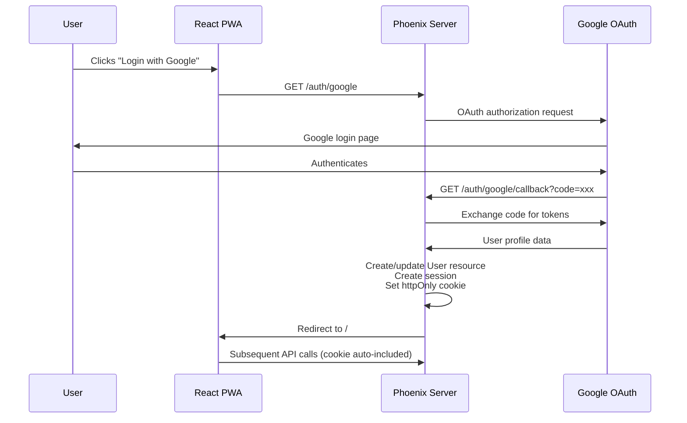
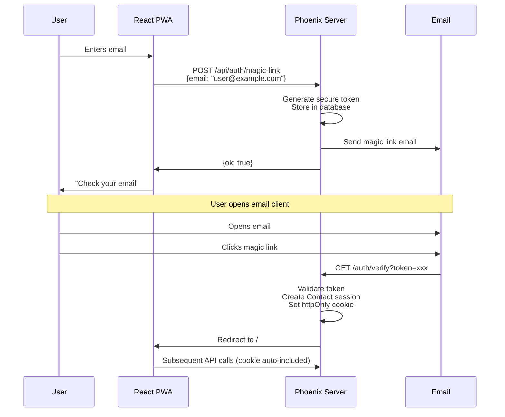
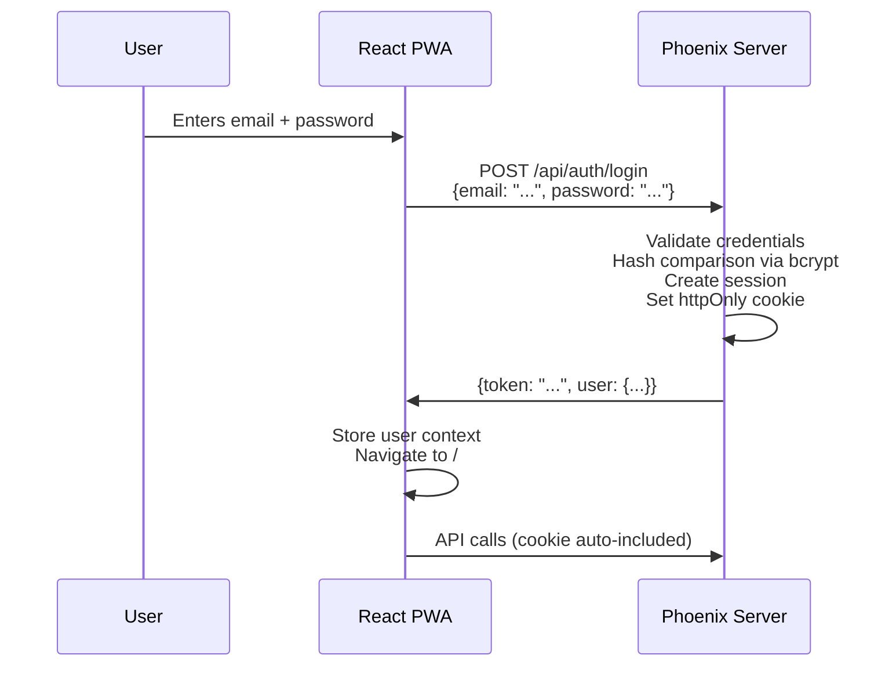

# Authentication Architecture

This document describes the authentication system for Chironium, a mobile-first CRM PWA with a decoupled architecture using React + Vite on the frontend and Elixir + Phoenix + Ash Framework on the backend.

## Architecture Overview

Chironium uses a **server-authoritative authentication model** where all authentication logic, session management, and security-sensitive operations are handled by the Elixir backend via Ash Authentication. The React PWA consumes these authentication services through standard HTTP flows and Phoenix sessions.

### Design Principles

- **Server-side authority**: All authentication logic lives on the backend
- **Cookie-based sessions**: httpOnly, secure cookies for session persistence
- **Separation of concerns**: Frontend handles UI, backend handles auth logic
- **Type safety**: Generated TypeScript hooks from Ash resources
- **Offline resilience**: PWA can function offline after initial authentication

## User Types

Chironium supports two distinct user types with different authentication methods:

### Internal Users (Staff)

**Resource**: `User` (defined in `lib/chironium/accounts/user.ex`)

**Authentication Methods**:

- Email + Password
- Google OAuth 2.0

**Use Case**: Staff members, administrators, service providers

### External Users (Customers)

**Resource**: `Contact` (defined in `lib/chironium/accounts/contact.ex`)

**Authentication Methods**:

- Magic Link (email-based, passwordless)

**Use Case**: Clients, customers, external contacts

> **Important**: These user types are strictly separated and use different resources. A contact cannot authenticate as a user and vice versa.

## Authentication Flows

### OAuth Flow (Internal Users)

OAuth is used for internal staff authentication via Google.



**Implementation Details**:

- OAuth provider configuration in Ash Authentication
- Callback URL: `https://app.chironium.com/auth/google/callback`
- User profile data mapped to `User` resource attributes
- Session created automatically after successful OAuth
- Cookie includes session token, httpOnly flag, secure flag (production)

### Magic Link Flow (External Users)

Magic links provide passwordless authentication for customer contacts.



**Implementation Details**:

- Token generation via `AshAuthentication.Strategy.MagicLink`
- Token stored in `tokens` table with expiration (default: 10 minutes)
- Email sent via Swoosh
- Token can only be used once
- After verification, token is deleted and session is created

### Password Flow (Internal Users)

Traditional email + password authentication for staff members.



**Implementation Details**:

- Passwords hashed with bcrypt via `Bcrypt.Elixir`
- Hash comparison is constant-time to prevent timing attacks
- Failed login attempts tracked for rate limiting
- Session token returned in response body and cookie

## Session Management

### Phoenix Sessions

Chironium uses Phoenix's built-in session management backed by cookies.

**Session Configuration**:

```elixir
# config/config.exs
config :chironium, ChironiumWeb.Endpoint,
  session_cookie: [
    signing_salt: "...",
    encryption_salt: "...",
    key: "_chironium_key",
    http_only: true,
    secure: true,  # true in production
    same_site: "Lax"
  ]
```

**Session Lifecycle**:

1. **Creation**: After successful authentication, Ash Authentication creates a session
2. **Storage**: Session data stored in signed/encrypted cookie
3. **Transmission**: Browser automatically includes cookie in requests to same domain
4. **Validation**: Phoenix validates cookie signature on each request
5. **Expiration**: Sessions expire after inactivity (configurable)

**Security Features**:

- `httpOnly`: Cookie cannot be accessed via JavaScript (XSS protection)
- `secure`: Cookie only sent over HTTPS in production
- `signed`: Cookie signature prevents tampering
- `encrypted`: Session data is encrypted
- `same_site: "Lax"`: CSRF protection

### Client-Side Session Handling

The React PWA does not manage sessions directly. Instead:

1. **Automatic inclusion**: Browser automatically includes session cookie in fetch requests
2. **Generated hooks**: Ash TypeScript hooks configured with `credentials: 'include'`
3. **No manual storage**: No need for localStorage/sessionStorage for auth tokens
4. **401 handling**: Hooks automatically detect 401 responses and trigger re-authentication

**Example - Generated Hook**:

```typescript
// Generated in client/src/lib/ash.ts
export function useGetUser() {
  return useQuery({
    queryKey: ["user"],
    queryFn: async () => {
      const response = await fetch("/api/users/me", {
        credentials: "include", // Automatically includes session cookie
        headers: {
          "Content-Type": "application/vnd.api+json",
        },
      });

      if (response.status === 401) {
        // Handle unauthorized - redirect to login
        window.location.href = "/login";
        throw new Error("Unauthorized");
      }

      return response.json();
    },
  });
}
```

## Routing Architecture

### Server Routes (Phoenix)

Authentication routes are handled server-side by Ash Authentication.

```elixir
# lib/chironium_web/router.ex

defmodule ChironiumWeb.Router do
  use ChironiumWeb, :router

  pipeline :browser do
    plug :accepts, ["html"]
    plug :fetch_session
    plug :protect_from_forgery
  end

  pipeline :api do
    plug :accepts, ["json"]
    plug :fetch_session  # Required for cookie-based auth
  end

  # Authentication routes (provided by Ash Authentication)
  scope "/auth" do
    pipe_through :browser

    # OAuth
    get "/:provider", AshAuthentication.Phoenix.Controller, :request
    get "/:provider/callback", AshAuthentication.Phoenix.Controller, :callback

    # Magic Link
    get "/verify", AshAuthentication.Phoenix.Controller, :verify
  end

  # API routes
  scope "/api" do
    pipe_through :api

    # Password authentication
    post "/auth/login", AshAuthentication.Phoenix.Controller, :sign_in
    delete "/auth/logout", AshAuthentication.Phoenix.Controller, :sign_out

    # Protected API endpoints (JSON:API)
    forward "/", ChironiumWeb.AshJsonApiRouter
  end

  # Serve PWA for all other routes
  scope "/" do
    pipe_through :browser

    # Catch-all route serves index.html for client-side routing
    get "/*path", ChironiumWeb.PageController, :index
  end
end
```

**Route Responsibilities**:

| Route Pattern              | Handler            | Purpose                         |
| -------------------------- | ------------------ | ------------------------------- |
| `/auth/:provider`          | Ash Authentication | Initiate OAuth flow             |
| `/auth/:provider/callback` | Ash Authentication | OAuth callback                  |
| `/auth/verify`             | Ash Authentication | Magic link verification         |
| `/api/auth/login`          | Ash Authentication | Password authentication         |
| `/api/auth/logout`         | Ash Authentication | Session termination             |
| `/api/*`                   | AshJsonApiRouter   | API endpoints (JSON:API)        |
| `/*`                       | PageController     | Serve PWA (client-side routing) |

### Client Routes (React Router/TanStack Router)

The PWA handles its own routing client-side.

```typescript
// client/src/routes/index.tsx
import { createBrowserRouter } from 'react-router-dom';

export const router = createBrowserRouter([
  {
    path: '/',
    element: <RootLayout />,
    children: [
      { index: true, element: <HomePage /> },
      { path: 'login', element: <LoginPage /> },
      { path: 'dashboard', element: <ProtectedRoute><Dashboard /></ProtectedRoute> },
      { path: 'clients', element: <ProtectedRoute><ClientsPage /></ProtectedRoute> },
      // ... more routes
    ]
  }
]);
```

**URL Resolution Examples**:

- `https://app.chironium.com/` → PWA (React Router → HomePage)
- `https://app.chironium.com/dashboard` → PWA (React Router → Dashboard)
- `https://app.chironium.com/auth/google` → Server (Phoenix → OAuth redirect)
- `https://app.chironium.com/auth/google/callback` → Server (Phoenix → OAuth callback)
- `https://app.chironium.com/api/clients` → Server (Phoenix → JSON:API)

> **Note**: Server routes (`/auth/*`, `/api/*`) take precedence over client routes. Phoenix serves `index.html` for all non-matching routes, allowing React Router to handle client-side navigation.

## Protected Routes

### Client-Side Protection

React components use a `ProtectedRoute` wrapper to enforce authentication.

```typescript
// client/src/components/protected-route.tsx
import { useCurrentUser } from '@/lib/hooks/use-current-user';
import { Navigate } from 'react-router-dom';

export function ProtectedRoute({ children }: { children: React.ReactNode }) {
  const { data: user, isLoading, error } = useCurrentUser();

  if (isLoading) {
    return <LoadingSpinner />;
  }

  if (error || !user) {
    // Redirect to login, preserving intended destination
    return <Navigate to="/login" state={{ from: window.location.pathname }} />;
  }

  return <>{children}</>;
}
```

**Usage**:

```typescript
<Route
  path="/dashboard"
  element={
    <ProtectedRoute>
      <Dashboard />
    </ProtectedRoute>
  }
/>
```

### Server-Side Protection

API endpoints are protected using Ash policies and Phoenix plugs.

```elixir
# lib/chironium/accounts/user.ex
defmodule Chironium.Accounts.User do
  use Ash.Resource, extensions: [AshAuthentication]

  policies do
    # Only authenticated users can read their own data
    policy action(:read) do
      authorize_if relates_to_actor_via(:id)
    end

    # Only admins can read all users
    policy action(:read) do
      authorize_if attribute(:role, :admin)
    end
  end
end
```

## Authentication State

### Current User Context

The PWA maintains current user state via a React context and hook.

```typescript
// client/src/lib/hooks/use-current-user.ts
import { useQuery } from "@tanstack/react-query";

export function useCurrentUser() {
  return useQuery({
    queryKey: ["current-user"],
    queryFn: async () => {
      const response = await fetch("/api/users/me", {
        credentials: "include",
        headers: { "Content-Type": "application/vnd.api+json" },
      });

      if (!response.ok) {
        if (response.status === 401) {
          return null; // Not authenticated
        }
        throw new Error("Failed to fetch current user");
      }

      const data = await response.json();
      return data.data; // JSON:API format
    },
    staleTime: 5 * 60 * 1000, // 5 minutes
    retry: false,
  });
}
```

**Usage in Components**:

```typescript
function UserMenu() {
  const { data: user } = useCurrentUser();

  if (!user) {
    return <LoginButton />;
  }

  return (
    <div>
      <Avatar src={user.attributes.avatar_url} />
      <span>{user.attributes.name}</span>
      <LogoutButton />
    </div>
  );
}
```

### Logout Flow

Logout clears the server-side session and invalidates client-side cache.

```typescript
// client/src/lib/hooks/use-logout.ts
import { useMutation, useQueryClient } from "@tanstack/react-query";
import { useNavigate } from "react-router-dom";

export function useLogout() {
  const queryClient = useQueryClient();
  const navigate = useNavigate();

  return useMutation({
    mutationFn: async () => {
      await fetch("/api/auth/logout", {
        method: "DELETE",
        credentials: "include",
      });
    },
    onSuccess: () => {
      // Clear all cached queries
      queryClient.clear();

      // Redirect to login
      navigate("/login");
    },
  });
}
```

## Error Handling

### 401 Unauthorized Responses

When the session expires or becomes invalid, the API returns 401.

**Global Axios Interceptor** (if using Axios):

```typescript
// client/src/lib/api-client.ts
import axios from "axios";

const apiClient = axios.create({
  baseURL: "/api",
  withCredentials: true,
  headers: { "Content-Type": "application/vnd.api+json" },
});

apiClient.interceptors.response.use(
  (response) => response,
  (error) => {
    if (error.response?.status === 401) {
      // Clear auth state
      queryClient.clear();

      // Redirect to login
      window.location.href = "/login";
    }
    return Promise.reject(error);
  },
);
```

**TanStack Query Error Handling**:

```typescript
// client/src/lib/query-client.ts
import { QueryClient } from "@tanstack/react-query";

export const queryClient = new QueryClient({
  defaultOptions: {
    queries: {
      retry: (failureCount, error) => {
        // Don't retry on 401
        if (error?.response?.status === 401) {
          return false;
        }
        return failureCount < 3;
      },
      onError: (error) => {
        if (error?.response?.status === 401) {
          window.location.href = "/login";
        }
      },
    },
  },
});
```

## Security Considerations

### CSRF Protection

- `protect_from_forgery` plug enabled in Phoenix router
- CSRF token embedded in HTML meta tag for client-side requests
- Session cookies use `same_site: "Lax"` for additional protection

### XSS Protection

- Session tokens stored in httpOnly cookies (not accessible via JavaScript)
- Content Security Policy (CSP) headers configured
- All user-generated content sanitized before rendering

### Password Security

- Passwords hashed with bcrypt (configurable cost factor)
- Minimum password requirements enforced
- Password reset via magic link (no email-based password transmission)

### Rate Limiting

- Login attempts rate-limited per IP address
- Magic link requests rate-limited per email address
- Implemented via `Ash.Resource.rate_limit` or Phoenix plugs

### Token Expiration

- Magic link tokens expire after 10 minutes (configurable)
- Sessions expire after 30 days of inactivity (configurable)
- OAuth tokens refreshed automatically when near expiration

## PWA Offline Behavior

### Service Worker Strategy

The PWA uses a **network-first** strategy for authentication:

```javascript
// client/src/service-worker.ts
self.addEventListener("fetch", (event) => {
  // Auth endpoints always go to network
  if (
    event.request.url.includes("/auth") ||
    event.request.url.includes("/api/auth")
  ) {
    event.respondWith(fetch(event.request));
    return;
  }

  // Other API requests: network-first with cache fallback
  // ...
});
```

### Offline Authentication State

- User data cached after initial login
- Offline requests queue until connectivity restored
- Authentication status persists across offline periods
- Re-authentication required after extended offline periods

## Implementation Checklist

### Backend (Elixir/Phoenix/Ash)

- [x] Ash Authentication configured
- [x] User resource with password + OAuth strategies
- [x] Contact resource with magic link strategy
- [x] Phoenix session configuration
- [x] Authentication routes in router
- [x] Policies for protected resources
- [ ] Email templates for magic links
- [ ] Rate limiting configuration
- [ ] Token cleanup background job

### Frontend (React PWA)

- [x] Generated TypeScript hooks from Ash resources
- [x] TanStack Query for state management
- [ ] Login/signup UI components
- [ ] Protected route wrapper
- [ ] Current user context/hook
- [ ] Logout functionality
- [ ] 401 error handling and redirect
- [ ] Service worker for offline support
- [ ] Auth state persistence across page reloads

## Testing Strategy

### Backend Tests

```elixir
# test/chironium/accounts/user_test.exs
defmodule Chironium.Accounts.UserTest do
  use Chironium.DataCase

  describe "password authentication" do
    test "authenticates with valid credentials" do
      user = create_user(email: "test@example.com", password: "password123")

      assert {:ok, authenticated_user} =
        User.sign_in_with_password("test@example.com", "password123")

      assert authenticated_user.id == user.id
    end

    test "rejects invalid password" do
      create_user(email: "test@example.com", password: "password123")

      assert {:error, _} =
        User.sign_in_with_password("test@example.com", "wrong_password")
    end
  end
end
```

### Frontend Tests

```typescript
// client/src/components/__tests__/protected-route.test.tsx
import { render, screen } from '@testing-library/react';
import { ProtectedRoute } from '../protected-route';

describe('ProtectedRoute', () => {
  it('redirects to login when not authenticated', () => {
    mockUseCurrentUser({ data: null, isLoading: false });

    render(
      <ProtectedRoute>
        <div>Protected Content</div>
      </ProtectedRoute>
    );

    expect(window.location.pathname).toBe('/login');
  });

  it('renders children when authenticated', () => {
    mockUseCurrentUser({ data: mockUser, isLoading: false });

    render(
      <ProtectedRoute>
        <div>Protected Content</div>
      </ProtectedRoute>
    );

    expect(screen.getByText('Protected Content')).toBeInTheDocument();
  });
});
```

## References

- [Ash Authentication Documentation](https://hexdocs.pm/ash_authentication)
- [Phoenix Session Documentation](https://hexdocs.pm/phoenix/sessions.html)
- [TanStack Query Authentication](https://tanstack.com/query/latest/docs/react/guides/auth)
- [OAuth 2.0 Specification](https://oauth.net/2/)
