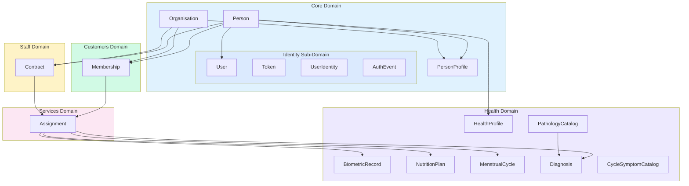
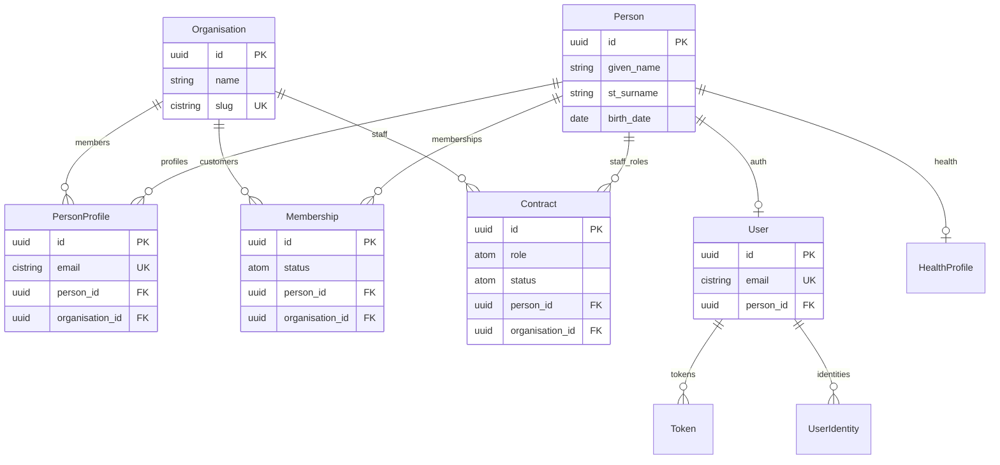
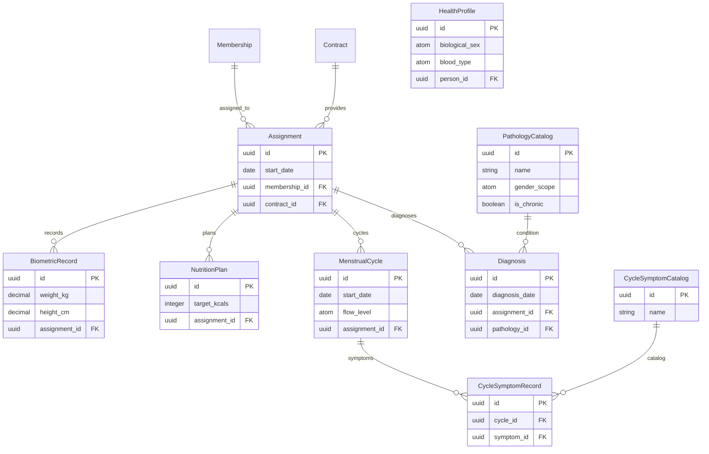
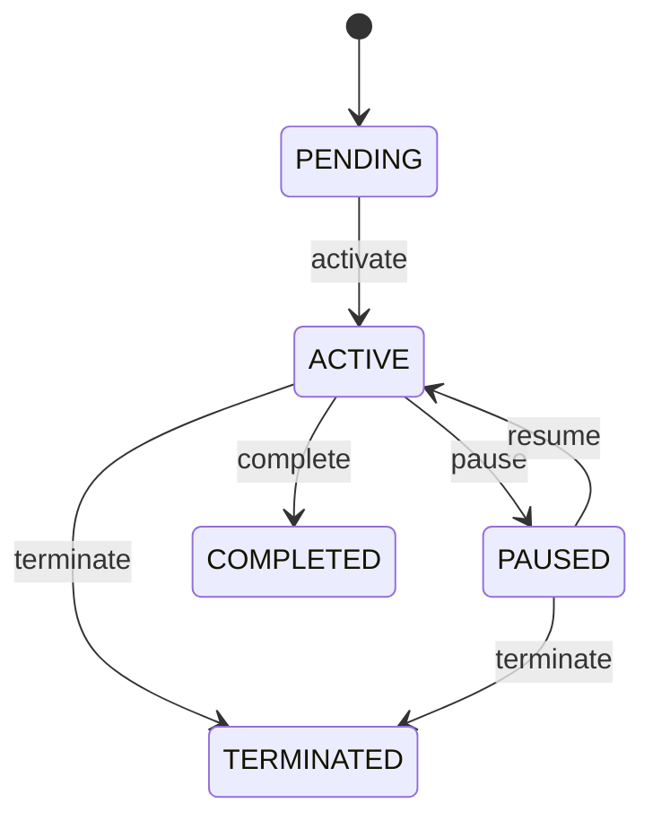
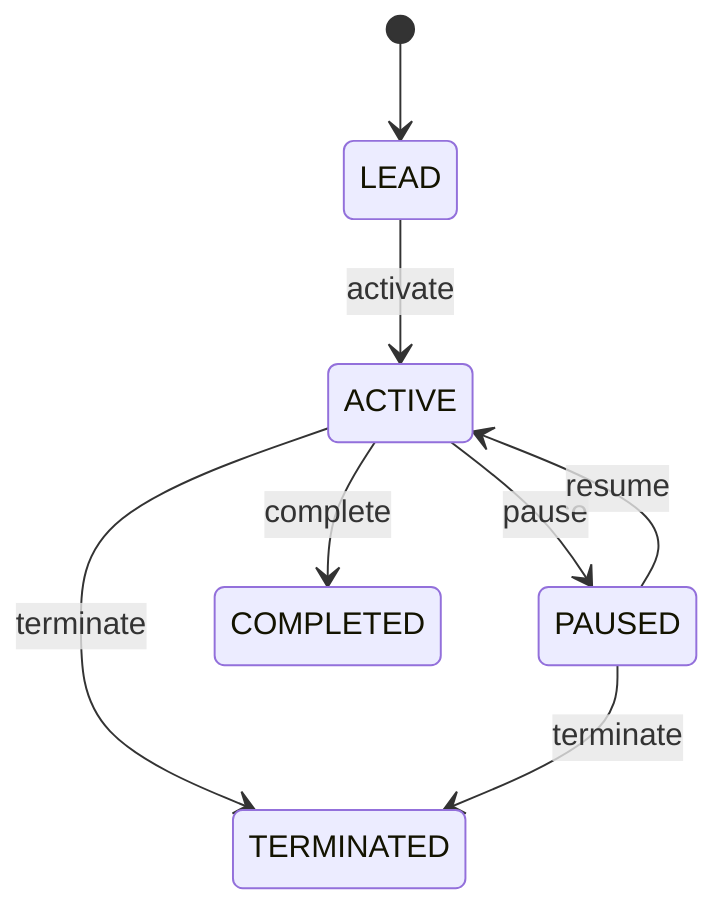

# Data Model Architecture

## Overview

Chironium follows a **domain-driven design** approach using the Ash Framework. The data model is organized into six distinct domains, each with clear responsibilities and well-defined boundaries.

### Domain Architecture

| Domain            | Description                                 | Resources                                                                                                                           |
| ----------------- | ------------------------------------------- | ----------------------------------------------------------------------------------------------------------------------------------- |
| **Core**          | Foundation entities (tenants, identity)     | Organisation, Person, PersonProfile                                                                                                 |
| **Core.Identity** | Authentication & authorization (sub-domain) | User, Token, UserIdentity, AuthEvent, AccountMergeRequest                                                                           |
| **Staff**         | Workforce management                        | Contract                                                                                                                            |
| **Customers**     | Customer relationship management            | Membership                                                                                                                          |
| **Services**      | Service delivery bridge                     | Assignment                                                                                                                          |
| **Health**        | Medical & health records (optional)         | HealthProfile, BiometricRecord, NutritionPlan, MenstrualCycle, Diagnosis, PathologyCatalog, CycleSymptomCatalog, CycleSymptomRecord |

### Domain Dependency Graph



## Entity Relationship Diagram

### Core & Staff/Customer Relationships



### Service Delivery & Health Records



## Core Domain

The foundation layer containing entities that all other domains depend on.

### Organisation

Top-level tenant entity representing a business in the system.

```elixir
# Key attributes
:name         # Business name (max 200 chars)
:slug         # URL-friendly identifier (unique, lowercase with hyphens)
:profile_picture  # Optional URL to logo
:theme_seed_color # Optional hex color for UI theming (#RRGGBB)
```

**Identities:**

- `unique_slug` — Slug must be globally unique.

**Relationships:**

- Has many `Memberships` (customers).
- Has many `Contracts` (staff).

---

### Person

Core identity for any individual (staff, customer, lead). Contains immutable personal identity data.

```elixir
# Key attributes
:given_name   # Personal/first name (OIDC: given_name)
:st_surname   # First surname (paternal in Spanish naming)
:nd_surname   # Second surname (maternal in Spanish naming)
:birth_date   # Date of birth
```

**Design Philosophy:**

- **Person** = Pure identity (legal name, DOB).
- **PersonProfile** = Org-specific contact info (email, phone, preferences).
- **User** = Authentication record (created lazily on first auth).

**Lifecycle:**

1. Person can exist without authentication (e.g., a lead created by staff).
2. User is created on first authentication (Google OAuth).
3. One Person can have multiple PersonProfiles across different organisations.

**Actions:**

| Action              | Description                                          |
| ------------------- | ---------------------------------------------------- |
| `:create`           | Creates a Person with full data                      |
| `:create_lead`      | Creates minimal Person (given_name, st_surname only) |
| `:create_from_auth` | Creates Person from OAuth user_info                  |
| `:update`           | Updates personal data                                |

**Calculations:**

| Calculation   | Type       | Description                                       |
| ------------- | ---------- | ------------------------------------------------- |
| `full_name`   | `:string`  | Joins given_name + st_surname + nd_surname        |
| `family_name` | `:string`  | Joins st_surname + nd_surname (OIDC: family_name) |
| `age`         | `:integer` | Calculated from birth_date                        |
| `has_auth`    | `:boolean` | True if User record exists                        |

---

### PersonProfile

Per-organisation profile preferences allowing different contact info per org.

```elixir
# Key attributes
:display_name     # Nickname/preferred name for this org
:gender           # Gender identity (:MALE, :FEMALE, :NON_BINARY, :OTHER, :PREFER_NOT_TO_SAY)
:email            # Org-specific email (ci_string, lowercase)
:phone            # E.164 format (+XXXXXXXXXXX)
:profile_picture  # Avatar URL
:country          # ISO 2-letter code
:city             # City name
:post_code        # Postal code
:notes            # Internal staff notes (private)
```

**Example Use Case:**

> María García at Gym A: `display_name: "Mari"`, `email: "mari@gym.com"`
> Same María at Clinic B: `display_name: "María"`, `email: "maria.garcia@clinic.com"`

**Multitenancy:**

- Scoped by `organisation_id` attribute strategy.
- `global? true` — Can query across tenants when needed.

**Identities:**

- `unique_person_org` — One profile per person per organisation.
- `unique_email` — Email unique across all profiles (partial index, WHERE email IS NOT NULL).

**Calculations:**

| Calculation              | Type      | Description                                      |
| ------------------------ | --------- | ------------------------------------------------ |
| `effective_display_name` | `:string` | Returns display_name or falls back to given_name |

---

## Staff Domain

Workforce management for staff relationships with organisations.

### Contract

Represents a staff relationship with an organisation (employment, contractor, etc.).

```elixir
# Key attributes
:start_date   # Contract start date
:end_date     # Optional contract end date
:role         # :OWNER, :MANAGER, :STAFF, :SALES
:status       # State machine state
```

**Roles:**

| Role      | Permissions                                         |
| --------- | --------------------------------------------------- |
| `OWNER`   | Full organisation control, can manage all contracts |
| `MANAGER` | Can manage contracts, memberships, assignments      |
| `STAFF`   | Service provider (trainer, nutritionist, etc.)      |
| `SALES`   | Can create/manage leads and memberships             |

**State Machine:**



| State        | Description                           |
| ------------ | ------------------------------------- |
| `PENDING`    | Contract created, awaiting activation |
| `ACTIVE`     | Currently active staff member         |
| `PAUSED`     | Temporarily paused (leave, etc.)      |
| `COMPLETED`  | Contract ended normally               |
| `TERMINATED` | Contract terminated early             |

**Actions:**

| Action             | From States       | To State     |
| ------------------ | ----------------- | ------------ |
| `:create`          | —                 | `PENDING`    |
| `:create_by_email` | —                 | `PENDING`    |
| `:activate`        | `PENDING`         | `ACTIVE`     |
| `:pause`           | `ACTIVE`          | `PAUSED`     |
| `:resume`          | `PAUSED`          | `ACTIVE`     |
| `:complete`        | `ACTIVE`          | `COMPLETED`  |
| `:terminate`       | `ACTIVE`,`PAUSED` | `TERMINATED` |

**Create by Email Flow:**

The `:create_by_email` action enables inviting new staff by email:

1. Accept email argument.
2. Find existing PersonProfile with that email → return Person.
3. If not found, create Person + PersonProfile.
4. User is NOT created yet (lazy creation on first auth).
5. Create Contract linked to Person.

**Identities:**

- `unique_active_person_org` — Only one active/paused contract per person per org.

**Multitenancy:**

- Scoped by `organisation_id`.

---

## Customers Domain

Customer relationship management.

### Membership

Represents a customer relationship with an organisation.

```elixir
# Key attributes
:start_date   # Membership start date
:end_date     # Optional end date
:status       # State machine state
```

**State Machine:**



| State        | Description                                |
| ------------ | ------------------------------------------ |
| `LEAD`       | Potential customer (not yet onboarded)     |
| `ACTIVE`     | Active paying customer                     |
| `PAUSED`     | Temporarily paused membership              |
| `COMPLETED`  | Membership completed (e.g., program ended) |
| `TERMINATED` | Membership terminated early (churn)        |

**Actions:**

| Action         | Description                            |
| -------------- | -------------------------------------- |
| `:create`      | Creates membership for existing person |
| `:create_lead` | Creates lead with minimal person data  |

**Create Lead Flow:**

The `:create_lead` action for quick lead creation:

1. Accept `given_name` and `st_surname` arguments.
2. Create Person with minimal data.
3. Create Membership in `LEAD` state.
4. No email required, no User created.

**Identities:**

- `unique_active_person_org` — Only one active/paused membership per person per org.

**Multitenancy:**

- Scoped by `organisation_id`.

---

## Services Domain

Bridge between staff and customers for service delivery.

### Assignment

Links a customer (Membership) to a staff member (Contract).

```elixir
# Key attributes
:start_date   # Assignment start date
:end_date     # Optional end date
```

**Purpose:**

- Enables staff to provide services to customers.
- Parent entity for all health records (biometrics, nutrition plans, etc.).
- Ensures data is tied to a specific staff-customer relationship.

**Auto-Population:**

- `organisation_id` is automatically derived from the linked Membership.

**Multitenancy:**

- Scoped by `organisation_id`.

**Relationships:**

- Belongs to `Membership` (customer).
- Belongs to `Contract` (staff member).
- Has many health records (`BiometricRecord`, `NutritionPlan`, `MenstrualCycle`, `Diagnosis`).

---

## Health Domain

Optional domain for medical and health record management. All health records belong to an Assignment.

### HealthProfile

Biological health data for a person, separate from gender identity.

```elixir
# Key attributes
:biological_sex  # :MALE, :FEMALE, :INTERSEX (for medical purposes)
:blood_type      # :A_POSITIVE, :A_NEGATIVE, :B_POSITIVE, etc.
:medical_notes   # General medical notes (private)
```

**Design Rationale:**

| Field            | Location      | Purpose                          |
| ---------------- | ------------- | -------------------------------- |
| `gender`         | PersonProfile | Social identity for CRM/comms    |
| `biological_sex` | HealthProfile | Medical accuracy for validations |

This separation allows:

- CRM to use gender identity for personalization.
- Health domain to use biological sex for medical validations.
- Menstrual cycle tracking only for `biological_sex: :FEMALE`.
- Gender-specific pathology validation.

**Identities:**

- `unique_person` — One health profile per person.

---

### BiometricRecord

Physical measurements for a customer.

```elixir
# Key attributes
:recorded_by    # :CUSTOMER or :STAFF
:record_status  # :PENDING_VALIDATION or :VALIDATED
:validated_at   # Timestamp when validated
:recorded_at    # When the measurement was taken
:weight_kg      # Weight in kilograms (decimal, 0-500)
:height_cm      # Height in centimeters (decimal, 0-300)
:measurements   # Embedded BodyMeasurements (see Embeds)
:notes          # Optional notes
```

**Calculations:**

| Calculation | Type       | Description                                     |
| ----------- | ---------- | ----------------------------------------------- |
| `bmi`       | `:decimal` | Body Mass Index: `weight_kg / (height_m)²`      |
| `bmr`       | `:decimal` | Basal Metabolic Rate (Mifflin-St Jeor equation) |

**BMR Calculation:**

Uses the Mifflin-St Jeor Equation (1990), recommended by the American Dietetic Association:

- **Men**: BMR = 10 × weight(kg) + 6.25 × height(cm) - 5 × age(years) + 5
- **Women**: BMR = 10 × weight(kg) + 6.25 × height(cm) - 5 × age(years) - 161

Requires: `weight_kg`, `height_cm`, `age` (from Person), `biological_sex` (from HealthProfile).

---

### NutritionPlan

Dietary plans with macronutrient targets.

```elixir
# Key attributes
:start_date    # Plan start date
:end_date      # Optional end date
:target_kcals  # Target daily calories (0-10,000)
:protein_gr    # Protein grams (0-1,000)
:fats_gr       # Fat grams (0-1,000)
:carbs_gr      # Carbohydrate grams (0-2,000)
:notes         # Optional notes
```

**Validation:**

- `MacroCalorieBalance` — Macros must sum to within ±50 kcals of target.

**Caloric Values:**

- Protein: 4 kcal/g
- Carbohydrates: 4 kcal/g
- Fats: 9 kcal/g

---

### MenstrualCycle

Cycle tracking for female customers.

```elixir
# Key attributes
:recorded_by    # :CUSTOMER or :STAFF
:record_status  # :PENDING_VALIDATION or :VALIDATED
:validated_at   # Timestamp when validated
:start_date     # Cycle start date
:end_date       # Cycle end date
:flow_level     # :LIGHT, :MEDIUM, :HEAVY, :VERY_HEAVY
:notes          # Optional notes
```

**Validation:**

- `MenstrualCycleFemaleOnly` — Only allowed for `biological_sex: :FEMALE`.

**Relationships:**

- Has many `CycleSymptomRecord` (symptoms linked to this cycle).

---

### Diagnosis

Links a customer to a pathology from the catalog.

```elixir
# Key attributes
:diagnosis_date  # Date of diagnosis
:end_date        # Optional (nil for chronic conditions)
:notes           # Optional notes
```

**Validation:**

- `DiagnosisGenderScopeMatch` — Gender-specific pathologies must match biological sex.

**Relationships:**

- Belongs to `PathologyCatalog` (the condition being diagnosed).
- Belongs to `Assignment` (the customer-staff relationship).

---

### PathologyCatalog

Reference catalog of medical conditions.

```elixir
# Key attributes
:name          # Condition name (unique)
:icd_code      # Optional ICD-10 code
:gender_scope  # :MALE_ONLY, :FEMALE_ONLY, :BOTH
:is_chronic    # Whether the condition is chronic
:description   # Optional description
```

**Purpose:**

- Read-only reference data.
- Used to validate diagnoses against patient's biological sex.
- Seeded from `priv/repo/seeds.exs`.

**Identities:**

- `unique_name` — Name must be unique.

---

### CycleSymptomCatalog

Reference catalog of menstrual cycle symptoms.

```elixir
# Key attributes
:name         # Symptom name (unique)
:description  # Optional description
```

**Purpose:**

- Read-only reference data.
- Seeded from `priv/repo/seeds.exs`.

**Identities:**

- `unique_name` — Name must be unique.

---

### CycleSymptomRecord

Links symptoms to specific menstrual cycles.

```elixir
# Relationships only
:menstrual_cycle  # The cycle this symptom belongs to
:symptom          # Reference to CycleSymptomCatalog
```

---

## Embedded Resources

### BodyMeasurements

Embedded in `BiometricRecord` for body circumference measurements.

```elixir
# All measurements in centimeters (decimal, precision: 5, scale: 2)
:waist_cm   # Waist circumference
:hip_cm     # Hip circumference
:chest_cm   # Chest circumference
:thigh_cm   # Thigh circumference
:arm_cm     # Arm circumference
:neck_cm    # Neck circumference
:calf_cm    # Calf circumference
```

All fields are optional, allowing partial measurements.

---

### CycleSymptom

Embedded symptom data with type and severity.

```elixir
:type       # :CRAMPS, :HEADACHE, :BLOATING, :FATIGUE, :MOOD_CHANGES,
            # :BACK_PAIN, :BREAST_TENDERNESS, :NAUSEA, :ACNE, :INSOMNIA

:severity   # :MILD, :MODERATE, :SEVERE
```

---

## Custom Validations

### MacroCalorieBalance

**Location:** `Chironium.Health.Validations.MacroCalorieBalance`

Validates that macronutrients sum to approximately the target calories in `NutritionPlan`.

**Formula:**

```txt
total_kcals = (protein_gr × 4) + (carbs_gr × 4) + (fats_gr × 9)
|total_kcals - target_kcals| ≤ 50
```

**Error:** `"macro calories must be within 50 kcals of target"`

---

### MenstrualCycleFemaleOnly

**Location:** `Chironium.Health.Validations.MenstrualCycleFemaleOnly`

Ensures menstrual cycle records are only created for biologically female users.

**Lookup Path:**

```txt
Assignment → Membership → Person → HealthProfile → biological_sex
```

**Error:** `"requires a biologically female user"`

---

### DiagnosisGenderScopeMatch

**Location:** `Chironium.Health.Validations.DiagnosisGenderScopeMatch`

Validates that gender-specific pathologies match the patient's biological sex.

**Rules:**

- `gender_scope: :BOTH` → Any biological sex allowed.
- `gender_scope: :MALE_ONLY` → Only `biological_sex: :MALE` allowed.
- `gender_scope: :FEMALE_ONLY` → Only `biological_sex: :FEMALE` allowed.

**Error:** `"biological sex does not match pathology scope"`

---

## Custom Calculations

### Person Calculations

| Calculation   | Module                                   | Description                              |
| ------------- | ---------------------------------------- | ---------------------------------------- |
| `full_name`   | `Chironium.Core.Calculations.FullName`   | Joins given_name, st_surname, nd_surname |
| `family_name` | `Chironium.Core.Calculations.FamilyName` | Joins st_surname, nd_surname             |
| `age`         | `Chironium.Core.Calculations.Age`        | Years since birth_date                   |

### Health Calculations

| Calculation | Module                              | Description                            |
| ----------- | ----------------------------------- | -------------------------------------- |
| `bmi`       | `Chironium.Health.Calculations.Bmi` | Body Mass Index from weight/height     |
| `bmr`       | `Chironium.Health.Calculations.Bmr` | Basal Metabolic Rate (Mifflin-St Jeor) |

---

## Policy Checks

### ActorIsOrgOwnerOrManager

**Location:** `Chironium.Staff.Checks.ActorIsOrgOwnerOrManager`

Verifies the actor has an OWNER or MANAGER role in the target organisation.

**Logic:**

1. Extract `organisation_id` from changeset or query.
2. Look up actor's `person_id`.
3. Check for active Contract with `role in [:OWNER, :MANAGER]` and `status in [:ACTIVE, :PAUSED]`.

**Used By:**

- Contract state transitions
- Membership state transitions
- Assignment management
- PersonProfile updates (for staff)
- Health record management

---

## Multitenancy Strategy

All organisation-scoped resources use attribute-based multitenancy:

```elixir
multitenancy do
  strategy :attribute
  attribute :organisation_id
  global? true
end
```

**Key Points:**

- Queries are automatically filtered by `organisation_id` when tenant is set.
- `global? true` allows cross-tenant queries when needed (e.g., admin dashboards).
- Tenant can be set via query arguments or context.

**Multitenant Resources:**

- PersonProfile
- Contract
- Membership
- Assignment
- (Health records inherit through Assignment)

---

## Seeds

Reference data is seeded via `priv/repo/seeds.exs`:

### PathologyCatalog Seeds

| Name                             | Gender Scope | Chronic |
| -------------------------------- | ------------ | ------- |
| Diabetes Type 1                  | BOTH         | ✅      |
| Diabetes Type 2                  | BOTH         | ✅      |
| Hypertension                     | BOTH         | ✅      |
| Hyperthyroidism                  | BOTH         | ✅      |
| Hypothyroidism                   | BOTH         | ✅      |
| PCOS (Polycystic Ovary Syndrome) | FEMALE_ONLY  | ✅      |
| Endometriosis                    | FEMALE_ONLY  | ✅      |
| Asthma                           | BOTH         | ✅      |
| Arthritis                        | BOTH         | ✅      |
| Osteoporosis                     | BOTH         | ✅      |
| Celiac Disease                   | BOTH         | ✅      |
| Anemia                           | BOTH         | ❌      |
| Depression                       | BOTH         | ✅      |
| Anxiety Disorder                 | BOTH         | ✅      |
| Migraine                         | BOTH         | ✅      |
| Fibromyalgia                     | BOTH         | ✅      |

### CycleSymptomCatalog Seeds

Cramps, Bloating, Headache, Mood Swings, Fatigue, Breast Tenderness, Acne, Lower Back Pain, Nausea, Diarrhea, Constipation, Food Cravings, Irritability, Anxiety, Insomnia, Hot Flashes, Dizziness, Joint Pain.

**Run Seeds:**

```bash
mix run priv/repo/seeds.exs
```

---

## ID Strategy

All resources use UUID v7 primary keys:

```elixir
uuid_v7_primary_key :id
```

**Benefits:**

- Time-ordered (sortable by creation time).
- Globally unique.
- No coordination required.
- Database-friendly indexing.

---

## Timestamp Strategy

All resources include:

```elixir
create_timestamp :created_at, type: :utc_datetime_usec
update_timestamp :updated_at, type: :utc_datetime_usec
```

Microsecond precision for accurate ordering and audit trails.

---

## Extensions Used

| Extension         | Purpose                               |
| ----------------- | ------------------------------------- |
| `AshPostgres`     | PostgreSQL data layer                 |
| `AshStateMachine` | State machine for Contract/Membership |
| `AshPaperTrail`   | Audit logging for User changes        |
| `AshGraphql`      | GraphQL endpoints                     |
| `AshAdmin`        | Admin UI                              |
| `Ash.Policy`      | Authorization policies                |

---

## Key Design Decisions

### 1. Person vs PersonProfile vs User

| Entity        | Purpose                    | Email?                    |
| ------------- | -------------------------- | ------------------------- |
| Person        | Pure identity (name, DOB)  | ❌ No                     |
| PersonProfile | Org-specific contact/prefs | ✅ Yes (per org)          |
| User          | Authentication tokens      | ✅ Yes (synced from auth) |

### 2. Gender vs Biological Sex

| Field            | Location      | Purpose                   |
| ---------------- | ------------- | ------------------------- |
| `gender`         | PersonProfile | Social identity (per org) |
| `biological_sex` | HealthProfile | Medical accuracy (global) |

### 3. Lazy User Creation

Users are NOT created during invitation:

1. Contract/Membership created → Person + PersonProfile only.
2. First authentication (Google OAuth) → User created.
3. Reduces unused User records.
4. Customers may exist without ever authenticating.

### 4. Assignment as Health Record Parent

All health records belong to an Assignment (not directly to Person):

- Ensures data is tied to a specific staff-customer relationship.
- Enables proper authorization (staff can only see their assigned customers' data).
- Maintains audit trail of who recorded what.

### 5. State Machines for Lifecycle

Both Contract and Membership use AshStateMachine:

- Clear state transitions with explicit actions.
- Prevents invalid state changes.
- Enables state-based authorization.

---

## Summary

The Chironium data model is designed for a **multi-tenant CRM** with optional health tracking:

| Aspect               | Implementation                                        |
| -------------------- | ----------------------------------------------------- |
| **Tenancy**          | Organisation-based, attribute strategy                |
| **Identity**         | Person (core) + PersonProfile (per-org) + User (auth) |
| **Staff**            | Contract with role-based permissions                  |
| **Customers**        | Membership with lifecycle states                      |
| **Service Delivery** | Assignment links staff ↔ customer                     |
| **Health Data**      | Optional domain, tied to Assignments                  |
| **Validations**      | Custom Ash validations for medical accuracy           |
| **Calculations**     | Derived fields (BMI, BMR, age, names)                 |
| **Authorization**    | Policy-based with role checks                         |
| **Audit**            | Paper Trail for User changes                          |
