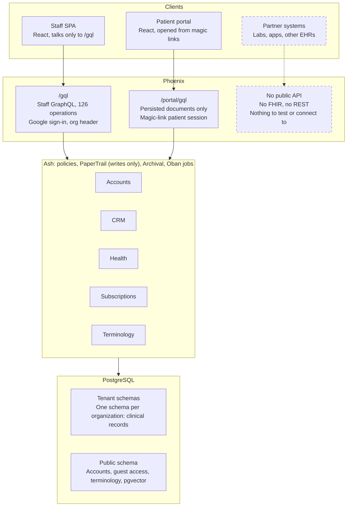
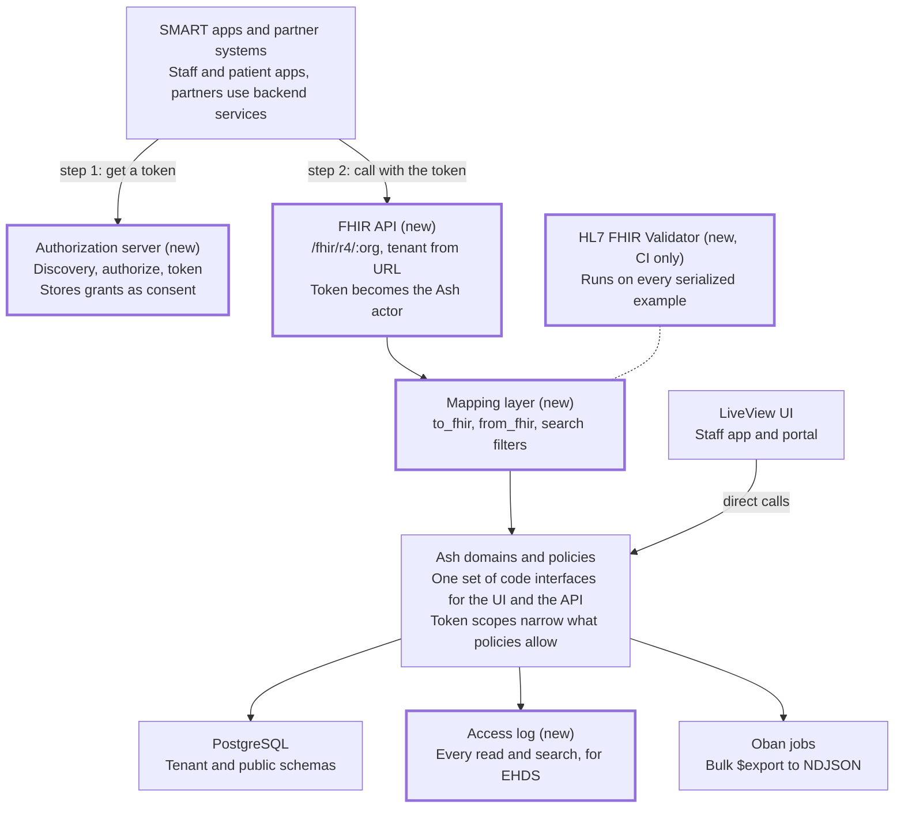
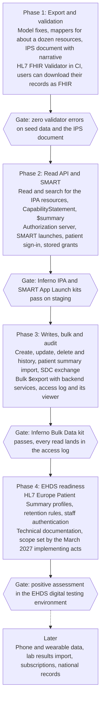

# Chironium FHIR Interoperability Design

Written 2026-10-22.

## Summary

Chironium should speak **FHIR R4** through a **REST API layered over the existing Ash resources**. It should conform to **International Patient Access (IPA) 1.1.0** and **HL7 Europe Base/Core**, behind **SMART App Launch 2.2**. The data model is already FHIR-shaped (modelled on R5), so this is mapping and hardening work, not a rewrite.

Proof comes from the HL7 FHIR Validator running in CI and from the Inferno IPA and SMART test kits. HL7 certifies nothing; the claim is "R4, these guides, these interactions, this evidence".

The forcing function is the EU's European Health Data Space (EHDS). EHR systems must export and import the European exchange format, let customers switch vendors, and log every read. This applies from 26 March 2029 to products placed on the market, and from 26 March 2031 to SaaS.

**Decisions needed** (detail in Points to Clarify):

1. **Intended purpose.** Is Chironium sold as an EHR system for physicians, a wellness tool for trainers, or both? This decides whether EHDS Chapter III applies.
2. **Hosting model and markets.** SaaS, self-hosted licences, EU or Switzerland: these set the deadlines and the national profiles.
3. **Public API.** Does FHIR become the only public API, with GraphQL retired once the UI moves to LiveView?
4. **Authorization server.** Build SMART on an Elixir OAuth library, or run a dedicated identity server such as Keycloak?

**Headline gaps:**

- Nothing is exchanged as FHIR today: no FHIR JSON, no REST endpoints, no CapabilityStatement.
- Model details break core rules: Observation has no `category`, measurements are stored as `registered`, and Patient demographics live on a separate Person record.
- No resource carries an `identifier`, so national and practice IDs have nowhere to go.
- There is no OAuth authorization server, so no SMART apps, patient access API or backend services.
- Reads aren't audited, and history storage can't serve FHIR version reads.
- There is no bulk export, and R5 status codes need explicit R4 mapping rules.

**First step:** an export-only slice. Mappers plus a patient Bundle, validated in CI, fix the model gaps and deliver data portability before any FHIR API endpoint exists.

## Context and Goals

Chironium borrowed FHIR's shapes from day one, but nothing outside it can read or write its data as FHIR. Trainers, nutritionists and physicians use it for profiles, anthropometry, clinical history, nutrition plans, cycle tracking, questionnaires, goals and tasks. It is AGPL-3.0, multi-tenant, and localized in English and Spanish.

**Why now:**

- **Regulation.** The EHDS requires EHR systems to exchange data in the European exchange format and to log every access (see Regulatory).
- **Ecosystem.** Labs, hospitals, patient apps and national records speak FHIR. Without it, every integration is a custom project.
- **Portability.** GDPR Article 20 and EHDS Annex II both require data to leave with the patient or the customer. FHIR is the obvious structured format.
- **The UI rewrite.** A LiveView UI calls Ash directly and needs no API. The public API can then be designed for integrations instead of screens.

**Goals:**

1. Every record Chironium stores exports as FHIR R4 that validates against the base spec and the chosen guides.
2. A FHIR REST API per organization that third-party apps reach through SMART App Launch.
3. Patient summary import (IPS or EU Patient Summary), so onboarding doesn't start from a blank record.
4. Test evidence that backs a written conformance claim.
5. A credible path to EHDS conformity for the EHR-system use case.

**Non-goals:**

- A general-purpose FHIR server for arbitrary resources. Chironium exposes what it stores.
- US programmes: US Core, ONC certification, CMS interoperability rules.
- FHIR GraphQL, CDS Hooks, claims and billing.
- Replacing the Ash model with stored FHIR JSON.

## Current State

The domain model is FHIR-shaped, but every external surface is custom GraphQL and nothing serializes to FHIR. Most resources link the R5 spec in their module docs and reuse FHIR datatypes (HumanName, ContactPoint, CodeableConcept, Coding, Quantity, Period, Annotation, Age, Duration, Dosage).

Staff and patients each reach Ash through their own GraphQL endpoint. Partners have no way in, and every rule lives in Ash.

**Platform facts that shape the design:**

- **APIs.** `/gql` serves staff (126 operations generated by AshGraphql). `/portal/gql` serves patients and accepts persisted documents only. There is no REST API.
- **Tenancy.** Each organization is a Postgres schema (`org_<id>`), chosen by the `x-chironium-organizationid` header after a membership check. Accounts, guest access and terminology live in the shared public schema.
- **Identity.** Staff sign in with Google through AshAuthentication. Patients get single-use magic-link sessions (`GuestAccess`) scoped to one questionnaire request. `PrincipalGrant` maps a user to a Practitioner or Patient per organization.
- **Authorization.** Ash policies are the boundary. Staff and patients reach separate endpoints, a split the [2026-09-25 design decision](design-decisions.md) modelled on SMART's `user/*` and `patient/*` scopes.
- **History.** AshPaperTrail versions every tenant resource with its actor, in `changes_only` mode. It records writes, never reads.
- **Deletion.** AshArchival soft-deletes and cascades from Person and Patient.
- **Terminology.** Imported SNOMED CT (with the Spanish extension) and LOINC, a closure table for subsumption, and pgvector embeddings for search. `Coding.display` is computed at read time from the imported release.
- **Questionnaires.** Responses extract Observations keyed by LOINC codes, the same idea as SDC observation-based extraction.

**Resource fit.** Fit means how much of the FHIR resource Chironium can fill without new data.

| Chironium resource | FHIR R4 resource | Fit | Main gaps |
| --- | --- | --- | --- |
| Person + Patient | Patient | Partial | Demographics live on Person; no identifier, address, deceased or language |
| Practitioner | Practitioner, PractitionerRole | Partial | Name, active and birth date only; no identifier, qualification or telecom |
| Organization | Organization | Partial | Name, slug, locale and timezone only; no identifier, address or telecom |
| CareTeam, CareTeamParticipant | CareTeam | Good | Participant role is free text, not a CodeableConcept |
| Observation | Observation + vital-signs profiles | Partial | No category; status stays `registered`; code optional; effective time only as dateTime |
| Condition | Condition | Good | No category, recorder or asserter |
| AllergyIntolerance | AllergyIntolerance | Good | No reactions, criticality or category |
| MedicationRequest | MedicationRequest | Partial | R5 status `ended`; medication optional; reason must become R4 `reasonCode` |
| MedicationStatement | MedicationStatement | Partial | R5 status set; medication optional; no effective timing |
| Goal | Goal | Good | `continuous` is R5-only; due date must move under `target` |
| Task | Task | Good | `requestedPeriod` is R5-only; `for` covers patients only |
| Questionnaire | Questionnaire | Partial | `minValue`/`maxValue` flattened; `answerConstraint` is R5-only |
| QuestionnaireResponse | QuestionnaireResponse | Good | Author split across two foreign keys |
| NutritionPlan | NutritionOrder | Poor | Custom shape: kcal plus macro grams |
| CodeSystem, ValueSet, ConceptMap | Same names | Partial | ValueSet holds explicit members only, no compose rules |
| Plan, Subscription, SubscriptionPause | None | Not FHIR | Business data; stays internal |
| User, PrincipalGrant, Invitation, GuestAccess | None | Not FHIR | Identity; maps to SMART clients and tokens, not resources |

## What Conformance Means

Conformance is a claim you write and back with evidence; HL7 runs no certification. The base spec defines valid resources and the REST API. Implementation guides (IGs) add profiles, required search parameters and "must support" elements. A server publishes what it supports in a CapabilityStatement at `/metadata`.

A defensible claim names four things:

1. **Release:** FHIR R4 (4.0.1).
2. **Guides, with versions:** for example IPA 1.1.0 and HL7 Europe Base/Core 2.0.
3. **Interactions:** per resource, which of read, search (and which parameters), create, update, delete, history and operations.
4. **Evidence:** validator runs and test-kit reports, each naming the kit version and the guide version it tests.

Certification exists only where a regulator builds a programme on top of FHIR:

| Programme | Region | What it certifies | Relevance to Chironium |
| --- | --- | --- | --- |
| EHDS conformity | EU | Harmonised software components of EHR systems: self-declaration, CE marking, a mandatory digital testing environment | High for physician use |
| National programmes | Per country | Connection to a national record or ePrescription service | Only where a market requires it |
| ONC (g)(10) Standardized API | US | Certified EHR APIs, tested with Inferno | None |

Connectathons (HL7, IHE) produce peer-tested results, not certificates. Safe wording: "conforms to IPA 1.1.0; passes Inferno IPA kit vN". Avoid "FHIR certified" or an unqualified "FHIR compliant".

## Target Release and Implementation Guides

Target **FHIR R4 (4.0.1)** on the wire, and keep the R5-shaped internal model with explicit mapping at the edge. Every guide Chironium would conform to is published for R4, and Android Health Connect accepts R4 or R4B, not R5.

- **R5 (5.0.0, March 2023)** is the latest published release, but few guides or servers adopted it. Skip it on the wire.
- **R6 is not final.** Its first normative ballot ran in January 2026 and a second was planned for July 2026. Most estimates put publication in 2027.
- **When R6 lands** and the IPS and HL7 Europe guides publish R6 editions, add `/fhir/r6/...` beside R4. The mapping layer makes a second release an addition, not a migration.

**Guide stack.** Phase refers to the roadmap below.

| Guide | Version | FHIR | Role for Chironium | Phase |
| --- | --- | --- | --- | --- |
| [HL7 Europe Base and Core](https://hl7.eu/fhir/base/) | 2.0.1 (STU 2) | R4, R5 | EU baseline profiles for Patient, Practitioner and shared datatypes | Phase 1 |
| [International Patient Summary (IPS)](https://hl7.org/fhir/uv/ips/) | 2.0.1 (STU 2) | R4 | Patient summary document. Problems, Allergies and Medications sections are required, each with narrative | Phase 1 |
| [International Patient Access (IPA)](https://hl7.org/fhir/uv/ipa/CapabilityStatement-ipa-server.html) | 1.1.0 (STU 1) | R4 | Patient-facing read API. Patient read and search by `_id` and `identifier` are SHALL; other resources SHOULD | Phase 2 |
| [SMART App Launch](https://www.hl7.org/fhir/smart-app-launch/toc.html) | 2.2.0 | R4 | Authorization for apps, practitioners and patients; IPA requires it | Phase 2 |
| [HL7 Europe Patient Summary](https://hl7europe.eu/new-ballot-opened-for-the-european-patient-summary-fhir-implementation-guide/) | 1.0.0-ballot (closed 31 August 2026) | R4 | EHDS preview for patient summaries, built on IPS | Phase 4 |
| [Structured Data Capture (SDC)](https://hl7.org/fhir/uv/sdc/) | 4.0.0 (STU 4) | R4 | Questionnaire extensions and observation extraction | Phase 3 |
| [Bulk Data Access](https://hl7.org/fhir/uv/bulkdata/) | 3.0.0 (STU 3) | R4 | Whole-patient and whole-organization export | Phase 3 |
| [HL7 Europe Laboratory Report](https://hl7europe.org/hl7-europe-publishes-new-implementation-guides-for-ehds-priority-categories-of-health-data/) | 2.1.0 | R4 | Importing lab results | Later |
| Subscriptions R5 Backport | Not checked | R4 | Webhooks for partners | Later |
| [CH Core and CH IPS](https://build.fhir.org/ig/hl7ch/ch-ips/index.html) | Not checked | R4 | Swiss national profiles | If needed |

## Gap Analysis

Eleven model fixes stand between today's data and a clean R4 export. After that, the platform needs an API, an authorization server and audit logging.

**Data model**

| Area | Gap | Why it matters | Fix | Phase |
| --- | --- | --- | --- | --- |
| Observation | No `category` | The R4 vital-signs profile SHALL apply to weight, height and BMI, and requires `category = vital-signs` | Add `category`, set it in each `log_*` action, backfill | Phase 1 |
| Observation | `log_*` actions leave status at `registered` (`observation.ex:183`) | `registered` means "no result yet", so consumers may hide the values | Set `final` when logging; backfill existing rows | Phase 1 |
| Observation, MedicationRequest, MedicationStatement | `code` and `medication` are optional | Both are 1..1 in FHIR, so the validator rejects empty ones | Require them after a data check | Phase 1 |
| Patient, Practitioner, Organization | No `identifier` | IPA requires Patient search by identifier; national and licence numbers need a home | Add an Identifier datatype and `identifier` arrays | Phase 1 |
| Patient | Demographics live on CRM.Person; Patient has no attributes | A FHIR Patient carries its own name, gender, birth date and telecom | Mapper joins Person; decide whether Person stays (Points to Clarify) | Phase 1 |
| MedicationStatement | R5 statuses: `recorded`, `draft`, `entered-in-error` | R4 needs `active`, `completed`, `stopped`, `intended` and others | Derive the R4 status from the effective period, or store it | Phase 1 |
| MedicationRequest | R5 status `ended` | Not an R4 code | Map to `completed` or `stopped` by rule | Phase 1 |
| Questionnaire, Goal, Task | R5-only `answerConstraint`, `continuous`, `requestedPeriod` | R4 has no such elements | Emit cross-version extensions, or drop them with a documented loss | Phase 1 |
| Questionnaire | `minValue`/`maxValue` flattened into item JSON | Not valid FHIR; other tools ignore them | Re-wrap as core extensions on export, unwrap on import | Phase 1 |
| Coding | `display` computed from the imported release | A deployment without LOINC or SNOMED CT exports codes with no display | Store the display at write time | Phase 1 |
| Condition | No category | Consumers separate problem-list items from encounter diagnoses by category | Default `problem-list-item` on export; store it later | Phase 1 |
| NutritionPlan | Custom kcal and macro fields | No FHIR shape | Map to NutritionOrder `oralDiet.nutrient` | Phase 3 |
| AllergyIntolerance, CareTeam, Observation | No reactions or criticality; free-text roles; effective time only as dateTime | Optional in FHIR, but useful for safety and search | Add when a guide or customer needs them | Later |

**Platform**

| Area | Gap | Why it matters | Fix | Phase |
| --- | --- | --- | --- | --- |
| Serialization and API | No FHIR JSON, REST endpoints or CapabilityStatement | Nothing to test or connect to | Mappers first (export), then a `/fhir/r4/:org` Phoenix scope | Phase 1 |
| Tenancy | Organization picked by a custom header | FHIR clients and SMART apps can't send it | Organization slug in the base URL | Phase 2 |
| Authorization | No OAuth2 authorization server; AshAuthentication only signs users in | SMART, IPA, Bulk Data and third-party apps all need one | Add a SMART-capable authorization server (Security, Identity and Consent) | Phase 2 |
| Search | No FHIR search parameters | IPA requires `patient+category`, `patient+code` and `patient+category+date` on Observation, once Observation is supported | Translate parameters into `Ash.Query` filters per resource | Phase 2 |
| Versioning | No `meta.versionId`, `lastUpdated`, ETag or `If-Match` | Clients use them to detect changes and avoid lost updates | Derive from PaperTrail versions and `updated_at` | Phase 2 |
| History | PaperTrail stores `changes_only` diffs (`auditable.ex:21`) | `vread` and `_history` need whole versions | Switch to `:snapshot` mode, or rebuild versions from diffs | Phase 3 |
| Narrative | No human-readable narrative | IPS requires narrative in every section; R4 recommends it per resource | Render narrative from templates at export | Phase 1 |
| Audit | Reads are never logged | EHDS Annex II 3.2 requires logging every access: who, which data, when, from where | Access log on every read and search, plus review tools (3.3) | Phase 3 |
| Export | No bulk export | EHDS Annex II 2.6 forbids hindering export when switching systems; GDPR Article 20 | Bulk Data `$export` on Oban jobs | Phase 3 |
| Consent | No record of what a patient authorized | Sharing with apps needs an auditable consent trail | Store SMART authorizations as consent records | Phase 3 |
| Terminology | ValueSet holds explicit members only | Local validation against guide value sets needs compose rules | Use the HL7 validator's terminology server in CI; add compose later | Later |
| Retention | Archival only; no retention rules | EHDS Annex II 3.4 asks for retention by data origin and category | Retention rules per resource category | Phase 4 |
| Professional authentication | Google sign-in only | EHDS Annex II 3.1 asks for reliable identification of health professionals | Decide MFA or eID requirements (Points to Clarify) | Phase 4 |

## Proposed Architecture

A thin FHIR layer inside the Phoenix app translates FHIR requests into the Ash actions the UI already calls. Ash stays the system of record and the authorization boundary; FHIR is a projection of it.

Apps get a token from the authorization server, then call the FHIR API. The LiveView UI keeps calling Ash directly, so both paths share one set of rules.

**Routing and tenancy.** A `scope "/fhir/r4/:org"` pipeline resolves the organization slug to its tenant, turns the bearer token into an Ash actor, and dispatches to one controller. The base URL per organization is `https://<host>/fhir/r4/<org-slug>`, matching the `/orgs/:slug` move in the [LiveView proposal](liveview-carbon-proposal.md).

| Interaction | Route | Phase |
| --- | --- | --- |
| Capabilities | `GET /metadata` | 2 |
| SMART discovery | `GET /.well-known/smart-configuration` | 2 |
| Read, search | `GET /:type/:id`, `GET /:type?params` | 2 |
| Patient summary | `GET /Patient/:id/$summary` | 2 |
| Create, update, delete | `POST /:type`, `PUT /:type/:id`, `DELETE /:type/:id` | 3 |
| History | `GET /:type/:id/_history[/:vid]` | 3 |
| Bulk export | `GET /$export`, `GET /Patient/$export` (asynchronous) | 3 |
| Transaction, batch | `POST /` with a Bundle | Later |

**Mappers.** One module per resource, `to_fhir/1` and `from_fhir/1`, as plain functions over loaded Ash records. A small registry maps each FHIR type to its Ash resource, mapper and search parameters. Mappers call the domain code interfaces the LiveView plan adds, so both UIs and the API share one set of entry points.

**Search.** Each supported parameter becomes an `Ash.Query` filter: tokens match CodeableConcept JSON (as the existing `read_*` actions do), dates take FHIR prefixes (`ge`, `lt`), references resolve `patient=Patient/<id>`. `_count` maps to keyset pagination, and the cursor goes into `Bundle.link[next]`. Unknown parameters are ignored, or rejected with `Prefer: handling=strict`.

**Versions and concurrency.** `meta.versionId` comes from the PaperTrail version and `meta.lastUpdated` from `updated_at`. Reads return an ETag; updates honour `If-Match` and answer 412 on a stale version.

**Errors.** Every failure returns an OperationOutcome:

- Ash forbidden: 403, or 404 when existence itself is private (IPA allows both).
- Not found: 404. Archived: 410 Gone.
- Invalid input: 400 or 422, naming the offending element.

**Writes.** `from_fhir/1` rejects elements Chironium cannot store with a 422 that names them, instead of dropping data silently. Conditional create (`If-None-Exist`) and transactions come later.

**Documents.** `Patient/$summary` assembles an IPS `Bundle` of type `document`: a Composition plus the referenced resources, with section narrative rendered from HEEx templates.

**Validation.** CI serializes seed data and fixtures through the mappers and runs the HL7 FHIR Validator against R4 plus the IPA, IPS and HL7 Europe packages. Zero errors is the gate. Java stays a CI tool, never a runtime dependency.

**Code layout.** `lib/chironium/fhir/` holds mappers, search and the registry as pure, unit-tested functions. `lib/chironium_web/fhir/` holds the router scope, plugs and controller. No new Ash domain, and no new runtime dependency beyond the authorization server.

## API Strategy

Make FHIR REST the one public integration API, keep GraphQL internal while a UI still uses it, and don't build FHIR GraphQL. Two public contracts would double the documentation, tests and compatibility promises for one small team.

| Surface | Consumers today | Contract | Proposal |
| --- | --- | --- | --- |
| `/gql` | Staff SPA (126 operations) | Custom; the README warns it breaks between releases | Internal only. Remove once LiveView ships and no client depends on it. This reverses the LiveView proposal, which keeps `/gql` for API clients; reconcile the two |
| `/portal/gql` | Patient portal, persisted documents only | Custom | Goes when the portal moves to LiveView, as the LiveView proposal already plans |
| `/fhir/r4/:org` | None yet | HL7 FHIR R4 plus the guides in this doc | The public, documented, testable API |
| FHIR GraphQL (`$graphql`) | None | Trial Use, maturity 3 | Don't build. No test kit covers it and HL7 notes GraphQL itself is not a formal standard |

**Why FHIR over GraphQL for integrations:**

- Partners already have FHIR clients, libraries and test tools; nobody has a Chironium GraphQL client.
- HL7 owns the contract, so Chironium's schema can change internally without breaking anyone.
- Inferno and the validator can test it; nothing tests a custom GraphQL schema.

**The UI decision is not a prerequisite.** The [LiveView proposal](liveview-carbon-proposal.md) waits on a public release of the `carbon_live_view` package. If it stalls, the FHIR API ships beside GraphQL unchanged. If it lands, both share the same domain code interfaces.

**The patient portal has two options.** It can move to LiveView as proposed, or become a SMART patient app on the FHIR API, which would exercise IPA every day. LiveView is less work; the choice is listed under Points to Clarify.

**The [2026-09-25 role split](design-decisions.md) carries over.** SMART `patient/*` tokens resolve a Patient principal, `user/*` tokens a staff principal, and the Ash policies stay identical.

## Security, Identity and Consent

Chironium needs an OAuth 2.0 authorization server that speaks [SMART App Launch 2.2](https://hl7.org/fhir/smart-app-launch/STU2.2/conformance.html); AshAuthentication only signs users in. SMART requires PKCE with `S256` (never `plain`) and a `/.well-known/smart-configuration` document listing its capabilities.

**Who calls the API, and as whom:**

| Caller | Example scopes | Chironium principal | Status |
| --- | --- | --- | --- |
| App launched from inside Chironium (EHR launch) | `launch`, `user/Observation.rs` | Practitioner, through PrincipalGrant | New |
| Practitioner's standalone app | `openid fhirUser user/*.rs` | Practitioner | New |
| Patient's app (standalone patient launch) | `launch/patient patient/*.rs offline_access` | Patient | Needs durable patient sign-in |
| Partner system, bulk export (Backend Services) | `system/*.rs`, client credentials with a signed JWT | New API-client principal with an organization grant | New |

**Scopes narrow policies; they never widen them.** Ash policies still decide what a principal may do. One added policy check reads the token's granted scopes from the actor context, and both must pass. The patient allowlist proven by `patient_actor_matrix_test.exs` keeps applying.

**Authorization server options:**

| Option | Strengths | Costs |
| --- | --- | --- |
| [Boruta](https://readme.hex.pm/boruta/2.2.0), embedded | Elixir OAuth 2.0/OIDC provider library: PKCE, client credentials, JWT client authentication (RFC 7523), dynamic client registration. One runtime, shared users and tenancy | SMART launch context, scopes and discovery are ours to build and security-review; SMART support unverified |
| Keycloak or a similar identity server | Mature OAuth and OIDC | SMART needs community extensions with unconfirmed EHR-launch support; a second service and user sync |
| Hosted SMART authorization service | Fastest route to a passing SMART test kit | Recurring cost, a new data processor, less control |

Recommendation: a time-boxed Boruta spike in Phase 2, judged by Inferno's SMART kit, with Keycloak as the fallback. Never hand-roll OAuth.

**Patient identity is the hard part.** Patients sign in today only through single-use links tied to one questionnaire request. A SMART patient app needs a durable patient login, verified against the Patient record. One person can be a patient in several organizations, which are separate tenants.

**Consent and patient rights:**

- Store every SMART grant: client, scopes, patient, user, issue and expiry times, revocation. Patients and staff can list and revoke grants.
- EHDS Articles 3 to 10 give people rights to access, rectify, port and restrict their data, and to learn who accessed it. National access services deliver most of these, but the EHR system supplies the data, restriction flags and access logs behind them.

**API hardening:**

- Bearer tokens only on `/fhir`: no cookies, so no CSRF surface. CORS opens on the FHIR routes alone, for browser-based SMART apps.
- Short-lived access tokens; refresh tokens only with `offline_access`.
- Per-client rate limits, reusing the approach of the existing portal rate limiter.
- Consider a separate origin (for example `fhir.<host>`), as the 2026-09-25 decision already anticipates for the portal.

## Regulatory

The [EHDS](https://www.ehds.io/) ([Regulation (EU) 2025/327](https://eur-lex.europa.eu/eli/reg/2025/327/oj/eng)) is the only rule here that mandates interoperability features. Whether it binds Chironium depends on the intended purpose Sealambda states. This section reads the regulation's text; it is not legal advice.

**Scope (Article 2).** An *EHR system* stores, imports, exports, converts, edits or views priority-category data, and is "intended by the manufacturer to be used by healthcare providers when providing patient care". A *wellness application* processes health data "for purposes other than the provision of healthcare".

- **Physicians:** Chironium stores allergies, conditions and medications, which are patient-summary data, so physician use makes it an EHR system.
- **Nutritionists:** some countries regulate dietitian-nutritionists as health professions (Spain among them), which may make them healthcare providers.
- **Personal trainers:** wellness use. Labelling (Articles 47 and 48) applies only if Sealambda claims interoperability with EHR systems.

| Date | Milestone |
| --- | --- |
| 26 March 2025 | Regulation (EU) 2025/327 enters into force |
| 26 March 2027 | The exchange format (Article 15) and common specifications (Article 36) are due |
| 26 March 2029 | Wave 1: patient summaries, ePrescriptions and eDispensations, and EHR systems placed on the market that process them |
| 26 March 2031 | Wave 2: imaging, test results and discharge reports. Chapter III applies to SaaS and in-house EHR systems |

At the time of writing, the first binding date is about two and a half years away. The specifications that define the exchange format land in March 2027, before any build work for Phase 4 can be final.

**Dates (Article 105).** Chapter III applies to SaaS and in-house systems from 26 March 2031 (Article 26(2)). Products placed on the market that handle patient summaries or ePrescriptions are covered from 26 March 2029. The format (Article 15) and common specifications (Article 36) are due by 26 March 2027.

**Annex II duties mapped to work:**

| Requirement | What Chironium needs | Phase |
| --- | --- | --- |
| 2.1 Give access to data in the European format (EEHRxF) | FHIR read API and `$summary` with the HL7 Europe profiles | 2, then 4 |
| 2.2 Receive data in the EEHRxF | Patient summary import | 3, then 4 |
| 2.4 Structured entry granular enough to produce the EEHRxF | The data model fixes in the gap analysis | 1 |
| 2.5 No undue burden on authorised access and sharing | Documented API, self-service app registration | 2 |
| 2.6 Export when the customer replaces the system | Bulk Data `$export` | 3 |
| 3.1 Reliable identification and authentication of professionals | MFA or eID policy for staff | 4 |
| 3.2 Log every access: who, whose data, which categories, when, from where | Access log on reads and searches | 3 |
| 3.3 Tools to review logs, or export to external tools | Log viewer and export | 3 |
| 3.4 Retention and access rights by data origin and category | Retention rules | 4 |

**Conformity process:** technical documentation (Article 37), an information sheet (38), an EU declaration of conformity (39), the digital testing environment before market (40), CE marking (41) and registration in the EU database (49). Member States may add national requirements beyond the harmonised components (42).

**GDPR.** Health data is a special category under Article 9. Article 20 portability is served by the same FHIR export. Erasure requests collide with medical-record retention duties, so archival rules need a legal basis per country.

**Medical device rules (MDR).** The README states Chironium is not a medical device. Keep calculations such as BMI and suggested energy targets informational. Clinical decision support, for example CDS Hooks, would reopen that question.

**Terminology licences.** Each deploying organization needs its own SNOMED CT Affiliate Licence (see `docs/terminology.md`), and that includes the hosted edition. Exposing SNOMED CT content to third parties through FHIR would hand it to parties outside that licence.

**Switzerland.** The EHDS does not apply there. Swiss customers would mean CH Core and CH IPS profiles, and connecting to the Swiss electronic patient record (EPD) is a separate, IHE-based project.

## Integrations Roadmap

SMART App Launch comes first because every other integration rides on it. After that, value differs by persona: physicians gain most from patient summaries and lab results, trainers and nutritionists from phone and wearable data.

| Integration | What it gives | Who cares most | Standard | Phase |
| --- | --- | --- | --- | --- |
| Patient summary export | A portable summary for patients, other providers and EHDS 2.1 | Physicians, patients | IPS 2.0.1, then HL7 Europe Patient Summary | Phase 1 |
| Third-party apps | Apps launched from Chironium or used standalone by staff and patients | Everyone | SMART App Launch 2.2, IPA 1.1.0 | Phase 2 |
| Patient summary import | Onboarding from hospital or national records instead of retyping | Physicians, nutritionists | IPS, HL7 Europe Patient Summary | Phase 3 |
| Bulk export | Switching vendors, analytics, independent backups; EHDS 2.6 | Organization owners | Bulk Data 3.0.0 | Phase 3 |
| Questionnaire exchange | Import and export validated instruments with their scoring and extraction | Everyone | SDC 4.0.0 | Phase 3 |
| Phone health stores | Weight, activity, heart rate and sleep from clients' phones | Trainers, nutritionists | Apple HealthKit and Android Health Connect SDKs in a companion app; Health Connect medical records accept FHIR R4 or R4B and are still experimental | Later |
| Wearables and smart scales | Continuous measurements without manual entry | Trainers | Vendor APIs (not FHIR) mapped to Observations, directly or through an aggregator | Later |
| Lab results import | Lab values beside anthropometry | Physicians, nutritionists | HL7 Europe Laboratory Report 2.1.0 (DiagnosticReport and Observation) | Later |
| Change notifications | Partners learn about new or changed records without polling | Integrators | Subscriptions R5 Backport (R4) | Later |
| National records and ePrescription | Swiss EPD, national and regional records, ePrescription services | Physicians | National guides and IHE profiles | If needed |

Skip for now: US Core, CDS Hooks (it would reopen the medical-device question), claims and billing, and offering Chironium's terminology server to third parties (SNOMED CT licensing).

## Conformance Testing Strategy

Test in three layers: the validator on every pull request, Inferno kits against staging each release, and the EHDS testing environment once it exists. Each layer produces evidence a claim can cite.

| Layer | Tool | Checks | When | Gate |
| --- | --- | --- | --- | --- |
| Mapping | ExUnit | `to_fhir`/`from_fhir` round trips; R5-to-R4 status rules | Every commit | All pass |
| Profiles | HL7 FHIR Validator CLI | Serialized seed data and fixtures against R4 plus the IPA, IPS and HL7 Europe Base packages | Every pull request | Zero errors; warnings tracked |
| API | [Inferno](https://inferno.healthit.gov/test-kits/) IPA and SMART App Launch kits, run locally in Docker | Live server behaviour: searches, errors, authorization flows | Each release from Phase 2 | Every applicable test passes; report archived |
| API, later | Inferno Bulk Data and Subscriptions kits | `$export` and notifications | From Phase 3 | Same |
| Legal | EHDS digital testing environment (Article 40) | Harmonised components | Before placing on the market | Positive assessment in the technical documentation |

**Inferno kits lag the guides,** so a claim names both versions. As of 2026-10-22:

| Kit | Kit version | Maturity | Tests |
| --- | --- | --- | --- |
| International Patient Access | 0.7.2 | Medium | IPA 1.0.0 (current guide: 1.1.0) |
| SMART App Launch | 1.0.3 | Medium | STU 1, 2 and 2.2 |
| International Patient Summary | 0.12.0 | Low | IPS 1.1.0 (current guide: 2.0.1) |
| Bulk Data | 0.13.1 | Low | STU 1 and 2 (current guide: 3.0.0) |
| Subscriptions | 0.12.2 | Low | R5 and the R4 backport |

For IPS 2.0.1, the validator is the stronger evidence until the kit catches up.

**Optional evidence.** [Touchstone](https://healthit.gov/blog/healthit-certification/new-testing-method-available-for-standardized-api-criterion/) (AEGIS, commercial) produces third-party reports if a tender asks for them. HL7 and IHE Connectathons give peer testing with real partners.

**Claim template**, for the CapabilityStatement and a public conformance page:

> Chironium \<version> conforms to FHIR R4 (4.0.1), IPA 1.1.0 and HL7 Europe Base 2.0.1 for the resources in its CapabilityStatement. Evidence: HL7 FHIR Validator \<version>, zero errors on \<n> example resources; Inferno IPA kit 0.7.2 (IPA 1.0.0) and SMART App Launch kit 1.0.3 (STU 2.2), all applicable tests passing on \<date>.

Publish a Chironium implementation guide only if Chironium defines its own profiles or extensions. Until then, the CapabilityStatement plus this page is enough.

## Roadmap

Four phases, each closed by a test gate rather than a date. Phase 1 needs no FHIR API endpoint and no new runtime dependency, so it can start now, while the purpose and market questions are being answered.

A phase closes only when its gate passes. Items marked Later start when a customer needs them.

**Phase 1, export and validation.** Fix the model gaps, write mappers for about a dozen resources, build the IPS document with narrative, and run the validator in CI. A "Download FHIR summary" action gives users portability right away.

**Phase 2, read API and SMART.** Read and search for the IPA resources, the CapabilityStatement, `$summary`, the authorization server, and SMART EHR, standalone and patient launches with stored grants.

**Phase 3, writes, import, bulk and audit.** Create, update and delete; history from snapshot versions; patient summary import; Bulk `$export` with Backend Services; SDC questionnaire exchange; the access log and its viewer.

**Phase 4, EHDS readiness.** HL7 Europe Patient Summary profiles, retention rules, professional authentication, technical documentation and the testing environment. Its scope waits for the implementing acts due 26 March 2027.

**Relative size (estimate).** Phase 1 is the smallest: mapping code plus a CI job. Phase 2 is the largest, driven by the authorization server and patient identity. Phase 3 is broad but mostly routine. Phase 4 is mainly documentation and process.

**Next steps:**

- [ ] Decide intended purpose, markets and hosting model (Points to Clarify 1 to 3).
- [ ] Add the HL7 FHIR Validator to CI with Patient and Observation mappers over the seed data.
- [ ] Add Observation `category`, set `final` in the `log_*` actions, and backfill existing rows.
- [ ] Add an Identifier datatype to Person, Practitioner and Organization.
- [ ] Write the R5-to-R4 rules for MedicationStatement status and MedicationRequest `ended`.
- [ ] Decide whether PaperTrail moves to snapshot mode, and measure the storage cost.
- [ ] Time-box a Boruta spike against the Inferno SMART kit.
- [ ] Watch for the R6 publication and the EHDS implementing acts.

## Points to Clarify

Questions 1 to 4 decide whether the EHDS applies and when, so they come first. The rest can be settled as each phase starts.

| # | Question | Who decides | What the answer changes | Status |
| --- | --- | --- | --- | --- |
| 1 | Is Chironium sold as an EHR system for physicians, a wellness tool for trainers, or both (two editions)? | Sealambda, with counsel | Whether EHDS Chapter III, CE marking and Phase 4 apply | Open |
| 2 | Which markets come first: which EU countries, and Switzerland? | Sealambda | National profiles, identifier systems, SNOMED CT extensions, languages | Open |
| 3 | SaaS only, or also sold for self-hosting? Does free AGPL distribution count as placing on the market? | Sealambda, with counsel | EHDS deadline: 2031 for SaaS, 2029 for marketed products handling patient summaries | Open |
| 4 | Do nutritionists count as healthcare providers in the target countries? | Counsel | Whether nutritionist deployments are EHR use | Open |
| 5 | Does anyone outside Sealambda call `/gql` today? | Engineering | Whether GraphQL can go after LiveView or needs a deprecation period | Open |
| 6 | Patient portal: LiveView, or a SMART patient app on the FHIR API? | Engineering, product | Daily IPA exercise versus less work | Open |
| 7 | How do patients get durable accounts, and how is one person linked across organizations? | Product, engineering | SMART patient access and EHDS patient rights | Open |
| 8 | Authorization server: embed Boruta, run Keycloak, or buy a hosted SMART service? | Engineering | Phase 2 size, operations, security review | Open |
| 9 | Keep CRM.Person separate from Patient, or move demographics onto Patient? | Engineering | Mapper complexity; FHIR's Person means something else (a link between records) | Open |
| 10 | Which identifier systems: national health IDs per country, practice record numbers, professional licence numbers? | Product, counsel | The Identifier datatype, IPA search, privacy rules on national IDs | Open |
| 11 | MedicationStatement R4 status: derive from the effective period or store it? `ended` to `completed` or `stopped`? | Engineering, clinical advisor | Accuracy of exported medication lists | Open |
| 12 | Which Observation categories for circumferences, ratios, cycle data and food preferences? | Clinical advisor | How partners find these values (proposal in the appendix) | Open |
| 13 | PaperTrail snapshot mode, or rebuild versions from diffs? | Engineering | `_history` support and storage cost | Open |
| 14 | Is Google sign-in with organization MFA enough for EHDS Annex II 3.1, or is eID needed? | Counsel, product | Phase 4 authentication work | Open |
| 15 | What may the API expose under the SNOMED CT licence, for the hosted edition and for API clients? | Sealambda, counsel | Which codes and displays the API returns | Open |
| 16 | Retention periods per country, and how they meet GDPR erasure requests | Counsel | Archival and retention design | Open |
| 17 | Model NutritionPlan as NutritionOrder now, or wait for a partner who needs it? | Product | Phase 3 scope | Open |
| 18 | Rename the billing Subscriptions domain before adding FHIR Subscriptions? | Engineering | Avoids two unrelated "subscriptions" in code and docs | Open |

## Risks and Mitigations

The biggest risks are a homemade authorization server and EHDS specifications that diverge from today's HL7 Europe guides. The other risks are routine for a mapping layer.

| Risk | Effect | Mitigation |
| --- | --- | --- |
| A custom SMART layer on an OAuth library has a security flaw | Patient data exposed to the wrong app or tenant | Time-boxed spike, the Inferno SMART kit, an external security review before go-live, and the hosted option as fallback |
| The March 2027 implementing acts diverge from the HL7 Europe guides | Phase 4 profile rework | Profiles live only in the mapping layer; build on IPS, which the EU guide extends; size Phase 4 after the acts |
| A model change silently breaks FHIR output | Invalid exports reach partners | The validator gate in CI plus round-trip tests per mapper |
| A token or patient identity crosses organizations | Cross-tenant data leak | Tokens bound to one organization's base URL; extend the policy matrix tests to FHIR actors |
| FHIR search is slow on JSON CodeableConcepts | Timeouts for partners | GIN indexes (one already exists on `observations.code`), keyset pagination, an explicit `_count` ceiling |
| History snapshots and access logs grow storage | Higher hosting cost | Measure first; partition the access log; retention rules |
| Partners expect a general FHIR server | Support load and scope creep | The CapabilityStatement lists exactly what works; non-goals stay explicit |
| Inferno kits lag the guides | Claims that overstate | Claims name kit and guide versions; the validator covers newer guides |
| The API exposes SNOMED CT content beyond the licence | Licence breach | Legal answer to question 15 before Phase 2 |
| Phase 2 outgrows a small team | Delays | Phase 1 delivers value on its own; buy the authorization server if the spike fails |

## Alternatives Considered

A mapping layer over Ash wins because the model already fits FHIR and Ash already holds tenancy, policies and history. Each alternative below gives up one of those.

| Alternative | What it buys | Why not now |
| --- | --- | --- |
| Store FHIR JSON natively, as Aidbox and HAPI FHIR do | Lossless round trips; extensions for free | Rewrites every resource and loses typed attributes, calculations and many policies |
| Run HAPI FHIR or [Medplum](https://medplum.com/docs/api/fhir/operations/graphql) as the system of record | Mature REST, search and (Medplum) SMART; test kits pass sooner | A second runtime; tenancy, auth and policies duplicated; Ash bypassed or kept in sync |
| Replicate into an external FHIR server for reads | A quick read API | Two sources of truth, and authorization in two places. Possibly useful for a one-off migration or analytics |
| FHIR GraphQL in place of today's GraphQL | One query language for UI and partners | Trial Use, no test kit, few implementers |
| FHIR R5 on the wire | Matches the internal model | The guides and test kits are R4; Health Connect takes R4 or R4B |
| Wait for R6 | One migration fewer | R6 isn't final, the guides follow later, and the EHDS acts are due in March 2027 |
| A generic Ash extension that derives FHIR from resource definitions | Less code per resource | Premature for about a dozen irregular mappings (the Person join, R5-to-R4 rules). Extract one only if a pattern repeats |

## Appendix

**A. R5-to-R4 mapping rules (proposed).** Rules marked "to confirm" depend on question 11.

| Element | Internal (R5 shape) | R4 wire format | Rule |
| --- | --- | --- | --- |
| MedicationStatement.status | `recorded`, `draft`, `entered-in-error` | `active`, `completed`, `intended`, `stopped`, `entered-in-error` and others | `recorded` becomes `active` while the effective period is open, else `completed`; `draft` becomes `intended` (to confirm) |
| MedicationRequest.status | Includes `ended` | No `ended` | `ended` becomes `completed` (to confirm) |
| MedicationRequest.medication, MedicationStatement.medication | CodeableConcept, as R5's CodeableReference | `medicationCodeableConcept` | Copy the concept |
| MedicationRequest.reason | CodeableConcept list, as R5's CodeableReference | `reasonCode` | Copy the concepts |
| Goal due date | `due_date` column | `target.dueDate` | First target carries the date |
| Goal.continuous | Boolean | None | Cross-version extension, or omit |
| Task.requestedPeriod | Period | `restriction.period` | Copy the period |
| Questionnaire item `answerConstraint` | Code | None | Cross-version extension, or omit when `optionsOnly` |
| Questionnaire item `minValue`, `maxValue` | Flattened keys | Core `minValue` and `maxValue` extensions | Wrap on export, unwrap on import |
| Dosage frequency, period, period unit | Flattened fields | `timing.repeat` | Nest; `as_needed` becomes `asNeededBoolean` |
| Observation value columns | Four nullable columns | `value[x]` | Emit the one that is set |
| Person name, telecom, gender, birth date | On CRM.Person | On Patient | Join on export |

**B. Observation categories (proposed for question 12).**

| Measurement | Code | R4 category |
| --- | --- | --- |
| Body weight, body height, BMI | LOINC 29463-7, 8302-2, 39156-5 | `vital-signs` (profiled) |
| Waist, hip, chest, arm and thigh circumference | LOINC 8280-0, 56063-1, 8279-2, 56072-2, 8286-7 | `exam` |
| Waist-to-hip ratio | SNOMED CT 248367009 | `exam` |
| Menstrual period start, duration, menarche age | LOINC 8665-2, 3144-3, 63888-2 | `social-history` (to confirm) |
| Food preference, food aversion | SNOMED CT 1163282001, 248135001 | `social-history` |
| Values extracted from a questionnaire | The item's code | `survey`, plus the measurement's own category |

**C. Sources** (opened 2026-10-22):

- [FHIR publication history](https://hl7.org/fhir/history.html) and [FHIR version codes, including the R6 ballots](https://build.fhir.org/valueset-FHIR-version.html)
- [R4 vital signs](https://hl7.org/fhir/R4/observation-vitalsigns.html) and the [vital-signs profile](https://hl7.org/fhir/R4/vitalsigns.html)
- [FHIR GraphQL](https://hl7.org/fhir/graphql.html) and [Medplum's implementation](https://medplum.com/docs/api/fhir/operations/graphql)
- [FHIR conformance testing](https://fhir.org/conformance-testing), [Inferno test kits](https://inferno.healthit.gov/test-kits/), [Touchstone and Drummond](https://healthit.gov/blog/healthit-certification/new-testing-method-available-for-standardized-api-criterion/)
- [IPA server CapabilityStatement](https://hl7.org/fhir/uv/ipa/CapabilityStatement-ipa-server.html), [IPS Composition profile](https://hl7.org/fhir/uv/ips/StructureDefinition-Composition-uv-ips.json), [SMART App Launch 2.2 conformance](https://hl7.org/fhir/smart-app-launch/STU2.2/conformance.html), [SDC](https://hl7.org/fhir/uv/sdc/), [Bulk Data](https://hl7.org/fhir/uv/bulkdata/)
- [HL7 Europe Base and Core](https://hl7.eu/fhir/base/), [HL7 Europe guides announcement](https://hl7europe.org/hl7-europe-publishes-new-implementation-guides-for-ehds-priority-categories-of-health-data/), [EU Patient Summary ballot](https://hl7europe.eu/new-ballot-opened-for-the-european-patient-summary-fhir-implementation-guide/)
- [EHDS consolidated text](https://www.ehds.io/) and [Regulation (EU) 2025/327 on EUR-Lex](https://eur-lex.europa.eu/eli/reg/2025/327/oj/eng)
- [Health Connect medical records](https://developer.android.com/health-and-fitness/health-connect/medical-records) and its [data format](https://developer.android.com/health-and-fitness/health-connect/medical-records/data-format)
- [Boruta](https://readme.hex.pm/boruta)
- [LiveView and Carbon proposal](liveview-carbon-proposal.md)
