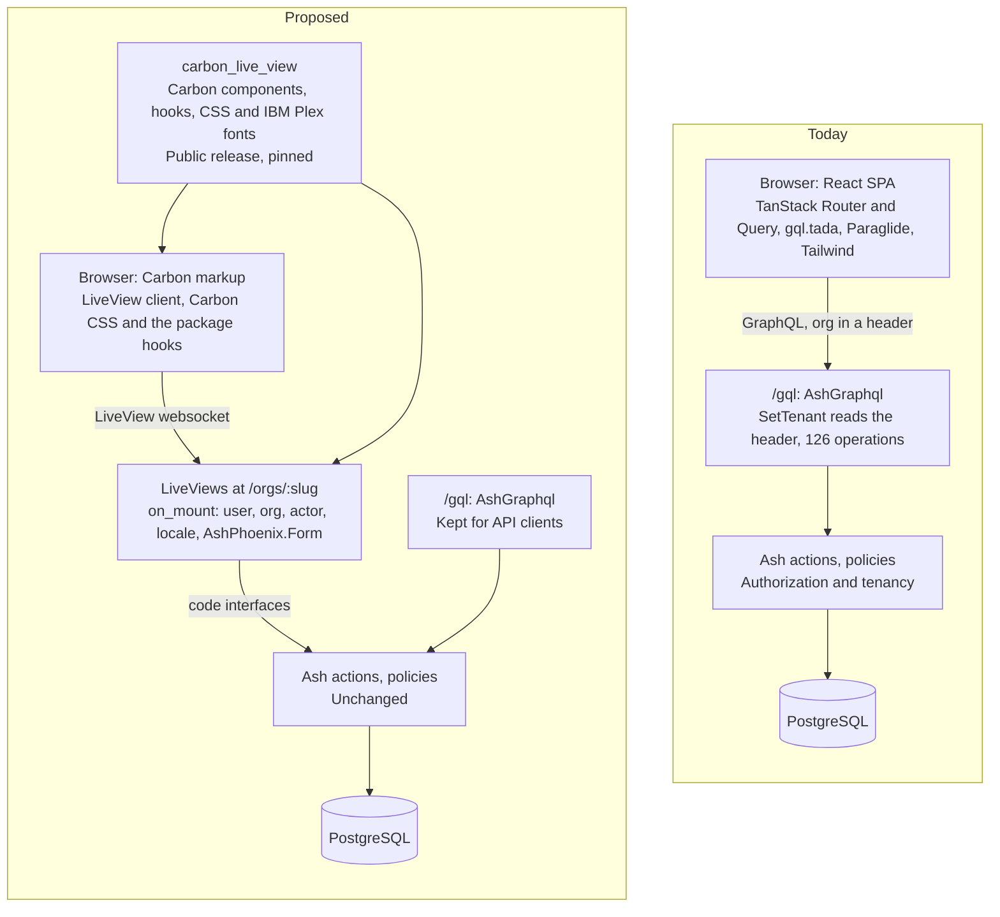
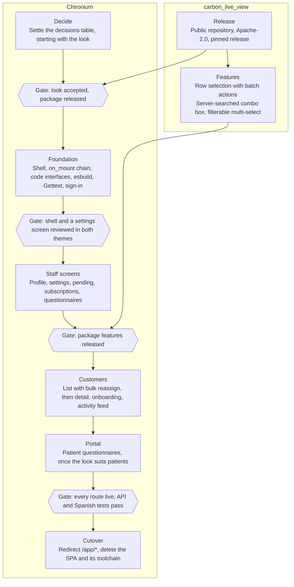

# Proposal: Chironium UI on LiveView and Carbon

Proposed 2026-10-22.

Rebuild Chironium's React single-page app as Phoenix LiveView screens built from `carbon_live_view`, route by route, in roughly 8–13 engineer-weeks. Two decisions gate the start: releasing the package under a licence Chironium can ship, and accepting Carbon's stock look.

## Context

Chironium's staff app and patient portal are React single-page apps that reach Ash only through GraphQL. Phoenix serves the staff app at `/app/*`, owns sign-in and sessions, and already renders sign-in as a LiveView.

| Today | Size |
| --- | --- |
| React and TypeScript source in `assets/src` | 41,023 lines in 352 files, including 4,004 lines of tests in 39 files |
| GraphQL operations exposed by AshGraphql | 40 queries and 86 mutations |
| GraphQL documents in the UI (gql.tada) | 90 |
| Ash code interfaces | 6 |
| Paraglide messages | 982 keys, in English and Spanish |
| Modal dialogs | 42, of which 31 are in customers |
| Playwright specs | 5 files, 1,043 lines |
| npm packages in `assets/package.json` | 36 dependencies and 26 dev dependencies |

`carbon_live_view` renders IBM Carbon v11 (reference release v11.118.0) as Phoenix function components. It emits Carbon's own markup over Carbon's compiled stylesheet, ships IBM Plex and every Carbon icon, and needs no Node step. It has 59 component modules plus layout and foundation modules.

The package is version 0.1.0-dev, lives in a private Sealambda repository, has no licence yet, and may change its interface until 1.0. Its bar is high: a unit test per component, a browser suite in Chromium, Firefox and WebKit with axe-core and IBM Equal Access scans, and screen reader passes. A larger internal Sealambda application already runs on it, which shows the approach at Chironium's scale.

## Goals and Non-Goals

The rebuild keeps every feature users have today and changes how screens are made, not what they do.

Goals:

- Every staff screen and the patient portal run as LiveViews built from `carbon_live_view`.
- Screens call Ash directly, through code interfaces and `AshPhoenix.Form`; Ash policies stay the only authorization.
- English and Spanish keep full coverage, with locale-aware dates and numbers.
- The production build no longer runs Vite, gql.tada or Paraglide.
- Screens meet the package's accessibility target: axe-clean, fully keyboard-operable, and checked with screen readers.

Non-goals:

- A visual identity beyond Carbon's themes. A custom brand is a separate decision, below.
- Changes to the data model, beyond adding code interfaces and moving TypeScript logic into Ash.
- Offline use. The app has no service worker today.
- Removing the public GraphQL API.
- Real-time collaboration. LiveView makes it cheap later, but it's out of scope here.

## Decisions to Make First

The first two rows block the start. The rest shape the design below and can be settled during the foundation phase.

| Decision | Recommendation | Why | Status |
| --- | --- | --- | --- |
| Release `carbon_live_view` publicly | Move the package to a public repository or Hex under Apache-2.0, and pin a release | Chironium is public AGPL; a private, unlicensed dependency can't ship in its CI, Docker image or contributors' clones | Open |
| Accept Carbon's stock look | Accept White and Gray 100 with IBM Plex for staff screens; decide the portal separately | The package forbids setting `--cds-*` tokens, and stock Carbon can feel stark on customer-facing pages | Open |
| Tenant in the URL | `/orgs/:slug/...` for every staff route | A websocket can't send the `x-chironium-organizationid` header; `Organization.slug` is already unique | Open |
| Markdown editor | Carbon text area, with markdown rendered on the server by MDEx or Earmark and sanitized before display | Carbon has no rich-text editor; keeping Tiptap needs a JavaScript hook and keeps npm in the build. The cost: practitioners type raw markdown instead of formatted text | Open |
| Build tool | Hex esbuild; drop Vite and the `phoenix_vite` fork | The package's install guide assumes esbuild resolving `phoenix-colocated` | Open |
| Tailwind and daisyUI | Remove them; lay out with Carbon's Grid, Stack and Layer | The package allows classes for layout only, and Tailwind would need fitting around its cascade layers | Open |
| Portal | Migrate it last, after the look is settled | Patients see it, and its persisted-document setup already works | Open |
| GraphQL API | Keep `/gql` and add API tests; remove `/portal/gql` once the portal moves | The README advertises the API, and it loses its only first-party consumer | Open |

## Target Architecture

LiveViews replace the SPA's GraphQL path. `/gql` stays only for API clients, and both reach the same Ash actions and policies.

## Design

LiveViews take over the browser end of each flow, while Ash actions, policies and the database stay as they are.

### URLs and Tenancy

- Staff routes move from `/app/*` to `/orgs/:slug/*`. They go in the router's existing, empty `ash_authentication_live_session :authenticated_routes`, above the SPA's catch-all, so both UIs run side by side during the migration.
- An `on_mount` chain replaces three plugs: the signed-in user, the organization and actor ported from `SetTenant` and `ActorResolver`, and the locale from `SetLocale`. Power users keep acting as their User; members with grants act as their Practitioner.
- An organization the user doesn't belong to resolves to "not found", never a distinguishable 403.
- `ChironiumWeb.AppUrl` builds the new links. Sent task reminders point at `/app/customers/:id` and invitations at `/app?inviteCode=`, so both redirect permanently, resolving the person's organization for the signed-in user.

### Data Access and Forms

- Each action a screen calls gets a domain code interface (`define`). Today there are 6, against 126 GraphQL operations.
- The 90 gql.tada documents list what each screen loads, and become each LiveView's `load:` options.
- Forms use `AshPhoenix.Form` with the mount's actor and tenant, and validate on `phx-change`. The rules in the 4 zod schemas (nutrition plan, onboarding, questionnaire, email) must exist in Ash; add any that don't.
- Lists use the package's `Pagination.params/2`, or streams where a list only grows.
- The questionnaire builder holds its item tree in assigns and saves it whole, where `ValidItemTree` already validates it. Moving an item up or down is a plain event, with no drag-and-drop hook.

### Screens and Composition

- The shell is `CarbonLiveView.UIShell`'s header and side nav, with `BottomNav` on phones. The header holds the organization switcher, language and theme.
- Each of the 42 dialogs becomes a `modal`. A simple one opens from the page with `commandfor`; one that's a step of the URL, such as `/orgs/:slug/customers/:id/conditions/new`, renders with `open` and patches back on close.
- Chironium's own components hold its patterns: page header, card grid, activity timeline, and toasts raised from flash. The package deliberately keeps app-level patterns out of its catalogue.
- `use CarbonLiveView` clashes with `core_components.ex` on `button/1` and `icon/1`. Import those with `except:` and retire `core_components.ex` as screens move.

### Styling

- `assets/css/app.css` declares `@layer cds, carbon-live-view, app;`, imports Carbon's stylesheet into `cds` and the package's colocated CSS, and keeps Chironium's rules in `app`.
- Chironium's CSS reads Carbon tokens such as `var(--cds-text-secondary)` and never sets them.
- `Plug.Static` serves the package's `priv/static` at `/carbon`, so IBM Plex loads from Chironium's own origin.
- The root layout renders `Theme.html_attrs/1`, `Theme.theme_script/1` with the CSP nonce, and one `LiveRegion.live_region/1`. The light and dark toggle maps to White and Gray 100.

### Translations

- A script converts Paraglide's 982 keys per locale into Gettext `.po` files. English text becomes the msgid, `{x}` becomes `%{x}`, and the 8 `_plural` key pairs become `ngettext` calls.
- Every word a package component renders is an attribute with an English default. A small helper passes Spanish chrome strings, such as close, clear and pagination ranges, on every call.
- `Cldr.DateTime.Relative` replaces date-fns relative times, and Cldr's spelled-out numbers replace n2words. Add `ex_cldr_numbers` to `mix.exs`; today it only arrives through another dependency.

### Auth, Portal and Analytics

- `SignInLive` is already a LiveView but is styled with Tailwind. It and the password-reset overrides get Carbon versions.
- The portal becomes its own `live_session` with its own root layout. It keeps the `no-referrer` header and takes its actor from the session, as `SetPortalActor` does now.
- `PortalRateLimit` throttles the portal API by IP, but websocket events bypass plugs. Portal event handlers apply the same Hammer limit.
- Once the portal moves, `/portal/gql`, `ChironiumWeb.PortalDocuments`, `RequirePersistedDocument` and `priv/graphql/portal-documents.json` go.
- PostHog's browser snippet stays in the root layout and records page views on LiveView navigation. Server events keep using the `posthog` package.

### Logic Now in TypeScript

Some domain logic runs only in the browser today. It moves to Elixir, preferably into Ash calculations and actions, so the API serves it too:

- The activity feed: about 3,200 lines in 30 files, including its timeline components, merging several queries in the browser.
- Nutrition-plan utilities, subscription progress and finished-state rules, and phone number utilities.
- The questionnaire builder's reducer and the fill helpers.

Their vitest files become the acceptance tests for the ports.

## Component Mapping

Nearly every shared UI piece has a Carbon component. Six need work in Chironium or the package: the last six rows.

| Today (`assets/src/shared`) | `carbon_live_view` | Note |
| --- | --- | --- |
| Side nav and bottom bar (`layout`) | `UIShell` header and `side_nav`, `BottomNav` |  |
| `dialog`, `form-dialog`, `alert-dialog` | `modal` | `alert` for confirmations, with a danger button |
| `data-table`, `table` | `data_table`, `table_toolbar_search`, `pagination` | Row selection is missing; see Package Changes |
| `button`, `back-button` | `button`, `icon_button`, `text_link` |  |
| `input`, `input-group`, `field`, `label` | `text_input`, `form_group` |  |
| `textarea` | `text_area` | Grows with its text where the browser supports it |
| `select`, `locale-select` | `select`, `dropdown` |  |
| `checkbox` | `checkbox`, `checkbox_group` |  |
| `toggle-group` | `content_switcher` |  |
| `date-picker`, `calendar` | `date_picker` | The browser's own calendar; no range picker |
| `number-stepper-input` | `number_input` |  |
| `badge` | `tag`, `action_tag` |  |
| `avatar` | `user_avatar` |  |
| `card` | `tile`, `clickable_tile` |  |
| `dropdown-menu` | `overflow_menu`, `menu_button` |  |
| `popover` | `toggletip`, `popover` |  |
| `step-indicator`, `responsive-step-indicator` | `progress_indicator` |  |
| `subscription-progress` | `progress_bar` |  |
| `sonner` toasts | `toast_notification`, raised from flash | Stays until closed; no auto-dismiss |
| `empty-state` | `empty_state` |  |
| `skeleton`, `loading` | `skeleton_text`, `skeleton_placeholder`, `loading`, `inline_loading` |  |
| `share-link-result` | `code_snippet` | Copy button with announced feedback |
| `list-search-field` | `search` |  |
| `language-toggle` | `UIShell.header_global_menu` |  |
| `sheet` | None in Carbon core | One importer; becomes a modal or an inline section |
| `terminology-tag-input` | None yet | Needs a server-searched combo box; see Package Changes |
| `markdown-editor`, `markdown-content` | `text_area`, with markdown rendered on the server | Or a Tiptap hook; see Decisions to Make First |
| `phone-input` | `dropdown` and `text_input` | Validated on the server |
| `contact-button-group` | `icon_button` | Carbon has no WhatsApp icon |
| Nutrition donut chart | Inline SVG in a Chironium component |  |

## Package Changes

The package needs a public release before Chironium can depend on it, plus two features Chironium's screens use.

Release:

1. Move the package to its own public repository, with a fresh history. Before that, remove links to private repositories from its docs, stories and tests.
2. License it Apache-2.0, matching Carbon. The Carbon stylesheet and IBM Plex fonts keep the licence files that already ship beside them.
3. Publish a pre-release to Hex, or tag a Git release.
4. Pin Chironium to that release, and upgrade every app that uses the package together, so they all test the same code.

Missing features:

| Feature | Chironium's use | Carbon React reference |
| --- | --- | --- |
| Row selection with batch actions in `data_table` | Bulk reassign on the customer list (`persons-page.tsx`) | `TableSelectRow`, `TableSelectAll` and `TableBatchActions` in DataTable |
| Server-searched combo box, and a filterable multi-select that accepts custom values | The terminology input searches SNOMED CT, LOINC and RxNorm, in 6 places | `ComboBox` with `onInputChange` and `allowCustomValue`; `FilterableMultiSelect` |

Today's `combo_box` filters only the options it's given, in the browser. The proposed version sends the typed text through a debounced `phx-change` and takes new options from the server; the existing hook already keeps an open list through a patch.

Both features go through the package's own gate: names from Carbon React, a unit test, a keyboard spec in the browser suite, and clean axe and Equal Access scans.

## Rollout

Each gate is a review point: work past it starts only once its condition holds. Each screen goes live when it's done. Its route sits above the SPA's catch-all, under its own root layout, and links between the two UIs are full page loads.

## Estimate

The rebuild takes about 8–13 engineer-weeks for one engineer working with coding agents, once the package is released.

| Phase | Estimate | Scope |
| --- | --- | --- |
| Foundation | 1–2 weeks | Shell, `on_mount` chain, code interfaces, esbuild and CSS layers, Gettext conversion, sign-in |
| Package features | 1–2 weeks | Row selection; server-searched combo box and filterable multi-select |
| Settings, profile, pending, subscriptions, questionnaires, portal | 2–3 weeks | About 10k React lines, tests included |
| Customers | 3–5 weeks | About 23k React lines: list, detail, onboarding wizard, 31 dialogs, activity feed |
| Cutover and cleanup | About 1 week | Redirects, deletions, CI, Dockerfile, `AGENTS.md` |
| Total | 8–13 weeks |  |

Assumptions:

- The total excludes the time to settle the two blocking decisions and release the package.
- Screens keep today's features, with no redesign beyond Carbon's themes.
- Chironium's 41k lines of TypeScript shrink in Elixir, because the `api/` folders (about 6k lines), the types and the client stores go away.

The widest error bars sit on customer detail and the package features, whose gate runs three browsers, accessibility scans and screen reader checks.

## Testing and Cleanup

Each migrated screen ships with its own tests, and the SPA's toolchain goes in one cleanup after cutover.

Testing:

- The 39 vitest files (4,004 lines) split two ways. Logic tests become ExUnit tests of the Elixir ports; component tests become `Phoenix.LiveViewTest` tests on `lazy_html`, already a test dependency.
- Each screen's tests cover its loads, events and forms, and check that a user outside the organization can't mount it.
- A test renders key screens in Spanish and fails on any English default left by the package.
- Playwright keeps the 5 end-to-end flows. Its 148 `data-testid` selectors move to roles and labels; 28 already use roles. The package's browser suite covers component behaviour, so Chironium's stays thin.
- The GraphQL API gets request tests for the operations external clients rely on, since no screen exercises them anymore.

Cleanup after cutover:

- Delete `assets/src`, the Vite config, the `phoenix_vite` fork, Tailwind, daisyUI, Paraglide and gql.tada.
- Remove Biome, knip, jscpd, dependency-cruiser, vitest and nearly all 62 npm packages. pnpm stays only for Playwright, and for Tiptap if it's kept.
- Drop the Dockerfile's `pnpm install` and `gql:generate` steps, and the matching steps in the CI workflows.
- Rewrite `AGENTS.md`. The package's usage rules replace the Tailwind design patterns and the TypeScript import rules, and the anthropometry file paths point at the new modules.
- Update the README's "Built with" section and its screenshots.

## Risks

The costliest risk is building screens in a look the team then rejects, which is why the look is settled first.

| Risk | Mitigation |
| --- | --- |
| The team rejects Carbon's look after screens exist | Settle the look before the foundation phase. Build the shell and one settings screen first, and review them in both themes |
| The package's interface changes before 1.0 | Pin a release, and upgrade every app that uses the package together. The package's changelog and naming test flag each change |
| The package features take longer under its gate | Start them during the foundation phase. The screens that need them, the customer list and the terminology input, come last |
| Logic ported from TypeScript regresses | Port each vitest case as an ExUnit test first, and move the logic into Ash where possible |
| The GraphQL API decays with no first-party consumer | Add API tests before deleting the SPA |
| Users meet two UIs during the migration | Separate root layouts, staff screens first, and an announced cutover date |
| Slow or unstable mobile networks | Presentational state stays in the browser, as the package designs it; searches debounce; set `longPollFallbackMs` |
| Spanish gaps from the package's English defaults | The chrome-string helper and the Spanish render test |
| Links in sent emails break | Permanent redirects from `/app/*`, kept indefinitely |

## Alternatives Considered

LiveView with `carbon_live_view` wins if the goal is one Elixir stack that shares components across Sealambda's apps. If the goal is only Carbon's look and accessibility, Carbon React in today's app is likely cheaper.

| Option | For | Against |
| --- | --- | --- |
| LiveView with `carbon_live_view`, route by route (proposed) | One Elixir stack, no GraphQL client layer, and components and accessibility testing shared across Sealambda's apps | Needs the package release and two package features; stock Carbon look |
| Carbon React (`@carbon/react`) in today's SPA | Carbon's look and accessibility without touching data, routing or translations | Keeps two languages, the GraphQL client layer and the client stores; shares no code with Sealambda's other apps |
| Keep today's React app | No migration cost | Two stacks and about 6k lines of GraphQL client code stay; no shared component work |
| LiveView with phx.new core components on Tailwind, or another kit | Keeps a Tailwind look and free styling | No shared investment with Sealambda's other apps; Chironium builds its own accessibility testing |
| Big-bang rewrite on a branch | One cutover and no mixed period | A branch drifts from `main` for 2–3 months, with no feedback until the end |
| LiveView with React islands for complex widgets | Keeps Tiptap and other rich inputs as they are | Two rendering models on one screen, and the React toolchain stays |

## References

Chironium, on `main`:

- [Router](https://github.com/sealambda/chironium/blob/main/lib/chironium_web/router.ex): the empty authenticated `live_session` and the SPA catch-all
- [SetTenant](https://github.com/sealambda/chironium/blob/main/lib/chironium_web/plugs/set_tenant.ex): the tenant header and actor resolution
- [AppUrl](https://github.com/sealambda/chironium/blob/main/lib/chironium_web/app_url.ex): the app links in emails
- [PortalRateLimit](https://github.com/sealambda/chironium/blob/main/lib/chironium_web/plugs/portal_rate_limit.ex): the portal's limits by IP
- [Customer list](https://github.com/sealambda/chironium/blob/main/assets/src/features/customers/pages/persons-page.tsx): row selection for bulk reassign
- [Terminology input](https://github.com/sealambda/chironium/blob/main/assets/src/shared/ui/terminology-tag-input.tsx)
- [AGENTS.md](https://github.com/sealambda/chironium/blob/main/AGENTS.md)

Carbon:

- [Carbon Design System](https://carbondesignsystem.com)
- [Carbon v11.118.0 source](https://github.com/carbon-design-system/carbon/tree/v11.118.0), the package's reference release
