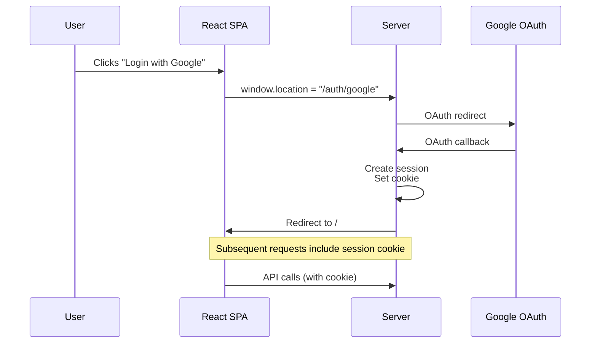
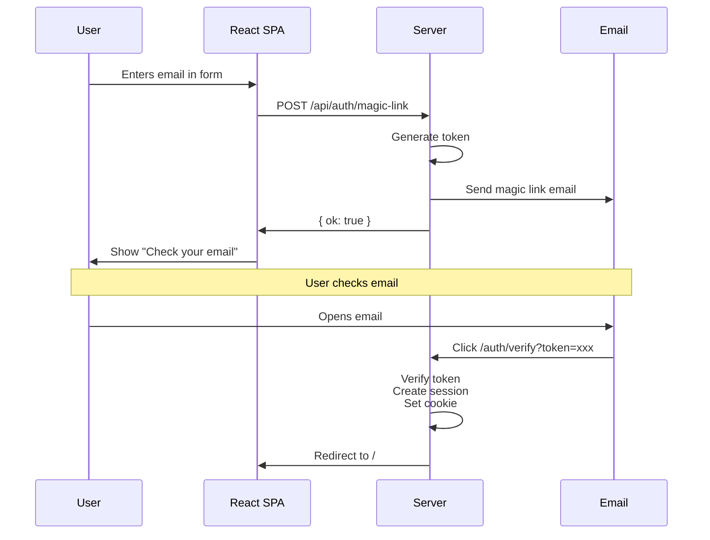
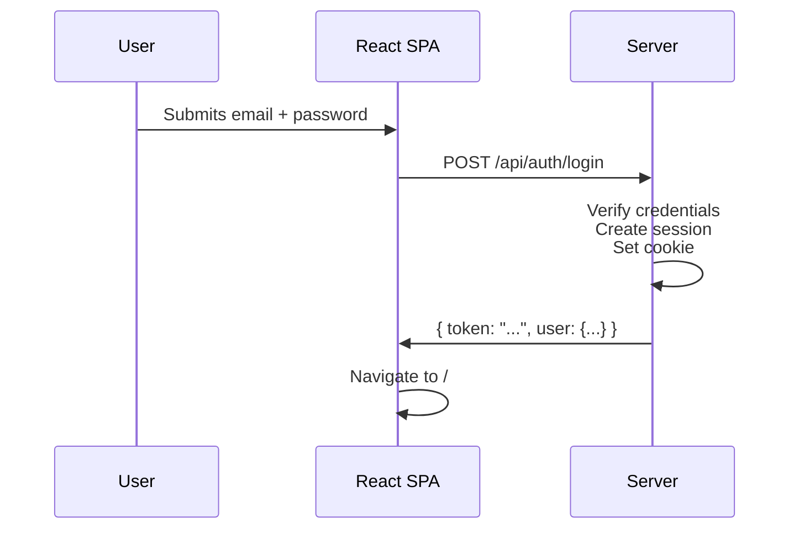

# SPA + Ash Authentication Architecture

## Overview

This document explains how authentication works in our vanilla SPA setup with Ash Authentication. The key insight: **we don't reimplement auth routes client-side** - the server handles all authentication complexity.

## Architecture

### Server-Side Responsibilities (Ash Authentication)

- OAuth redirect endpoints (`/auth/:provider`, `/auth/:provider/callback`)
- Magic link generation and verification endpoints
- Token/session creation and validation
- All authentication business logic
- Session cookie management

### Client-Side Responsibilities (React SPA)

- Consuming the authenticated session/token
- Making authenticated API requests via generated Ash hooks
- Redirecting to server auth endpoints when needed
- Displaying UI based on auth state

## Auth Flows

### 1. OAuth Flow (Google, etc.)



### 2. Magic Link Flow



### 3. Password Flow



## Session Management

### How Sessions Work

1. **Server creates session** after successful authentication
2. **Session cookie is set** (httpOnly, secure in production)
3. **Browser automatically includes cookie** in all requests to same domain
4. **Generated Ash TypeScript hooks** include `credentials: 'include'` by default
5. **No manual token handling needed** in React code

### Example: Making Authenticated Requests

```typescript
// In your React component
import { useGetUser } from '@/lib/ash';

function Dashboard() {
  // This hook automatically includes session cookie
  const { data: user, isLoading } = useGetUser();
  
  if (isLoading) return <div>Loading...</div>;
  
  return <div>Welcome, {user.name}!</div>;
}
```

The generated hook (`useGetUser`) handles:

- Including credentials (session cookie)
- Handling 401 responses (redirect to login)
- Type safety
- Caching and revalidation

## Routing Strategy

### Server Routes (Phoenix)

```elixir
# In lib/chironium_web/router.ex

scope "/auth" do
  # Ash Authentication provides these routes
  # No need to implement in React!
  
  # OAuth
  get "/:provider", AshAuthentication.Phoenix.Controller, :request
  get "/:provider/callback", AshAuthentication.Phoenix.Controller, :callback
  
  # Magic Link
  get "/verify", AshAuthentication.Phoenix.Controller, :verify
  
  # Password
  post "/login", AshAuthentication.Phoenix.Controller, :sign_in
  delete "/logout", AshAuthentication.Phoenix.Controller, :sign_out
end

# All other routes serve the SPA
scope "/" do
  get "/*path", PageController, :index  # Serves index.html
end
```

### Client Routes (React Router/TanStack Router)

```typescript
// In client/src/routes
const routes = [
  { path: '/', component: HomePage },
  { path: '/dashboard', component: Dashboard },
  { path: '/clients', component: ClientsPage },
  // etc.
];
```

### URL Examples

- `https://app.example.com/` → React SPA (HomePage)
- `https://app.example.com/dashboard` → React SPA (Dashboard)
- `https://app.example.com/auth/google` → Server (OAuth redirect)
- `https://app.example.com/auth/google/callback` → Server (OAuth callback)
- `https://app.example.com/auth/verify?token=xxx` → Server (Magic link verify)
- `https://app.example.com/api/clients` → Server (JSON:API endpoint)

## Implementation Checklist

### Already Done ✅

- [x] Ash Authentication configured with providers
- [x] Phoenix routes for auth endpoints
- [x] Generated TypeScript hooks with credentials support
- [x] React SPA with Vite
- [x] TanStack Query for state management

### To Implement

- [ ] Login/signup UI components in React
- [ ] Protected route wrapper component
- [ ] Auth state management (user context/hook)
- [ ] Redirect logic on 401 responses
- [ ] Logout button that calls server endpoint

## Example: Login Component

```tsx
// client/src/features/auth/login.tsx

export function LoginPage() {
  return (
    <div className="space-y-6">
      {/* OAuth Buttons */}
      <a 
        href="/auth/google"
        className="btn btn-primary"
      >
        Continue with Google
      </a>
      
      {/* Password Form */}
      <form 
        action="/api/auth/login" 
        method="POST"
        onSubmit={handlePasswordLogin}
      >
        <input type="email" name="email" />
        <input type="password" name="password" />
        <button type="submit">Sign In</button>
      </form>
      
      {/* Magic Link Form */}
      <form onSubmit={handleMagicLink}>
        <input type="email" name="email" />
        <button type="submit">Send Magic Link</button>
      </form>
    </div>
  );
}
```

## Benefits of This Approach

### ✅ No Reimplementation

- Ash Authentication handles all auth logic server-side
- OAuth redirects work out of the box
- No need to build auth flows in React
- Security-sensitive code stays on server

### ✅ Better for PWA

- SPA can be fully cached offline
- Auth endpoints are standard HTTP (work offline with fallback)
- Service worker can cache app shell independently
- Better offline-first experience than Inertia

### ✅ Standard Pattern

- This is how most SPAs work with backend auth
- Well-understood separation of concerns
- Easy to debug and reason about
- Matches user expectations

### ✅ Type Safety

- Generated TypeScript hooks provide full type safety
- Ash schema changes auto-sync to client
- No manual API client code needed

## Common Questions

### Q: Do we need to handle session storage in React?

**A:** No. Phoenix sessions use httpOnly cookies that are automatically included in requests. You just need to handle 401 responses and redirect to login.

### Q: What about token refresh?

**A:** Phoenix sessions handle this automatically. If using JWT tokens, Ash Authentication can provide refresh token endpoints that your React app calls periodically.

### Q: How do we protect routes in React?

**A:** Create a wrapper component that checks auth state:

```tsx
function ProtectedRoute({ children }) {
  const { data: user, isLoading } = useCurrentUser();
  
  if (isLoading) return <Loading />;
  if (!user) return <Navigate to="/login" />;
  
  return children;
}
```

### Q: What if the server auth routes conflict with React routes?

**A:** They won't - server auth routes are at `/auth/*` and `/api/*`, React routes are everything else. Phoenix router serves SPA for unmatched routes.

## Comparison: Inertia vs Vanilla SPA

| Aspect                 | Inertia                           | Vanilla SPA                |
| ---------------------- | --------------------------------- | -------------------------- |
| **Auth Integration**   | Slightly easier (server-rendered) | Easy (standard OAuth flow) |
| **Initial Setup**      | Faster                            | Already done ✅             |
| **PWA Support**        | Limited                           | Excellent                  |
| **Offline-First**      | Difficult                         | Natural fit                |
| **Mobile Performance** | Good                              | Better (full caching)      |
| **Complexity**         | More dependencies                 | Simpler stack              |
| **Type Safety**        | Manual types                      | Generated types ✅          |

## Conclusion

**The vanilla SPA approach is ideal for this project** because:

1. Auth routes stay server-side (no reimplementation needed)
2. Better PWA/offline support for mobile-first requirements
3. Cleaner separation of concerns
4. Generated TypeScript hooks provide excellent DX
5. Already configured and working

The auth integration is **not harder** than Inertia - it's just a different mental model where the server handles auth and the SPA consumes it, which is actually simpler for a decoupled architecture.
